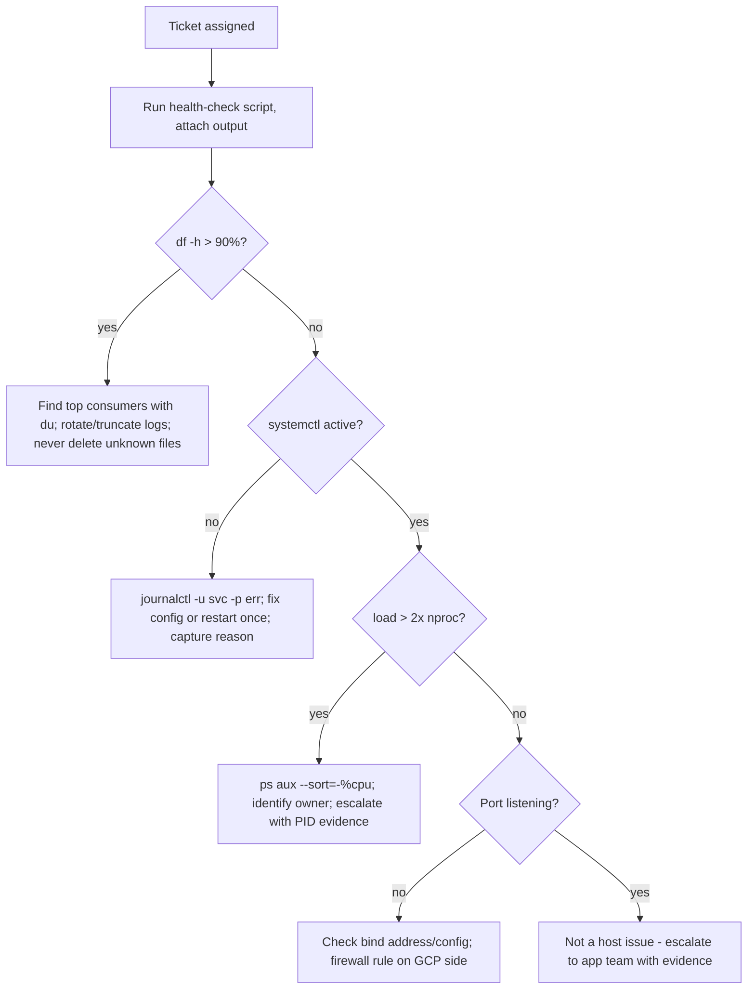

# Project 02 — L1 On-Call: Linux Health-Check & Log Triage Runbook

| | |
|---|---|
| **Module** | 1 — Linux Basics & GCP Free Tier |
| **Level** | L2 — Engineer |
| **Role you play** | L1 Support / Linux Operations Engineer on a 24×7 rota |
| **Scope** | Linux process, memory, disk, service, network and log commands from `Linux-basic-commands.md` |

---

## 1. Business problem

Your team supports 40 Linux servers. Tickets arrive as vague one-liners: *"server is slow"*,
*"application is down"*, *"disk alert"*. New L1 engineers either escalate everything immediately
(annoying L2) or poke around randomly (dangerous).

The Operations Manager wants a **triage runbook**: a fixed set of commands an L1 runs in the
first 10 minutes of any ticket, the decision tree for what to do with the findings, and the
exact information to put in the escalation note.

## 2. Objectives

1. Build a **health-check script** that captures the state of a server in one run.
2. Write a **triage decision tree** for the four most common ticket types.
3. Prove the runbook works by **reproducing each fault** on a lab VM and resolving it.
4. Produce a standard **escalation template** so L2 never has to ask "what have you checked?".

## 3. Scope

**In scope:** `top`/`ps`, `free`, `df`/`du`, `systemctl`, `journalctl`, `ss`, `ip`, `kill`,
`grep`, `tail`, `find`, `uptime`, `dmesg`, `apt`. All from Module 1.

**Out of scope:** monitoring tooling (Module 10 covers Prometheus), config management, APM.
This project is deliberately "hands and eyes on the box".

---

## 4. Standard Operating Procedure (SOP)

> **SOP ID:** OPS-SOP-002 · **Title:** Linux first-response triage
> **Target:** complete §4.5 within 10 minutes of ticket assignment

### 4.1 Severity definitions

| Sev | Definition | First response | Escalate after |
|---|---|---|---|
| S1 | Service down, customer impacting | Immediate | 15 min |
| S2 | Degraded / partial impact | 15 min | 30 min |
| S3 | Single-host resource warning | 1 hour | 4 hours |
| S4 | Query / request | Next business day | — |

### 4.2 Golden rules

1. **Capture before you change.** Run the health check *first*; the evidence disappears when you fix it.
2. **Never `kill -9` as a first action.** Try `systemctl restart`, then `kill`, then `kill -9`.
3. **Never delete a file you did not identify.** `du` first, confirm owner and purpose, then act.
4. **Never free disk by deleting application logs you cannot name.** Truncate rotated logs instead.
5. **Everything you type goes in the ticket.** If it is not written down, it did not happen.

### 4.3 First-response sequence

| # | Question | Command |
|---|---|---|
| 1 | Is the box up and for how long? | `uptime` |
| 2 | Is it CPU bound? | `top -b -n1 | head -20`, `uptime` load vs `nproc` |
| 3 | Is it memory bound / swapping? | `free -h`, `vmstat 1 5` |
| 4 | Is the disk full? | `df -h`, `df -i` |
| 5 | Is the service running? | `systemctl status <svc>` |
| 6 | What do the logs say? | `journalctl -u <svc> -p err --since "30 min ago"` |
| 7 | Is it listening? | `ss -tulpn | grep <port>` |
| 8 | Can it reach the network? | `ip route`, `ping -c3 <gw>`, `curl -sI <endpoint>` |

### 4.4 Decision tree



### 4.5 Escalation template

```
TICKET      : <id>            SEVERITY: <S1-S4>
HOST        : <hostname> / <ip>        OS: Ubuntu 26.04 LTS
SYMPTOM     : <verbatim user report>
START TIME  : <first occurrence from logs>
CHECKS RUN  : uptime, top, free, df -h/-i, systemctl status, journalctl, ss -tulpn
FINDINGS    : <facts only, with command output>
ACTIONS     : <what you changed, with exact commands>
CURRENT STATE: <up / degraded / down>
WHY ESCALATING: <what is outside L1 authority>
ATTACHMENTS : health-check-<host>-<timestamp>.txt
```

---

## 5. Hands-on implementation

### Step 1 — Build the health-check script

```bash
sudo mkdir -p /opt/ops/bin && sudo chown $USER /opt/ops/bin
vim /opt/ops/bin/healthcheck.sh
```

```bash
#!/usr/bin/env bash
# L1 first-response health check - read-only, safe to run any time.
set -u
OUT="/tmp/health-$(hostname -s)-$(date +%Y%m%d-%H%M%S).txt"

section() { printf '\n===== %s =====\n' "$1"; }

{
  section "IDENTITY";      hostnamectl; date
  section "UPTIME/LOAD";   uptime; echo "CPUs: $(nproc)"
  section "TOP CPU";       ps -eo pid,user,pcpu,pmem,etime,comm --sort=-pcpu | head -11
  section "TOP MEM";       ps -eo pid,user,pcpu,pmem,etime,comm --sort=-pmem | head -11
  section "MEMORY";        free -h
  section "SWAP ACTIVITY"; vmstat 1 3
  section "DISK SPACE";    df -h -x tmpfs -x devtmpfs
  section "DISK INODES";   df -i -x tmpfs -x devtmpfs
  section "BIGGEST /var";  du -xh /var --max-depth=2 2>/dev/null | sort -rh | head -10
  section "FAILED UNITS";  systemctl --failed --no-pager
  section "RECENT ERRORS"; journalctl -p err -b --no-pager | tail -30
  section "LISTENERS";     ss -tulpn | grep -i listen
  section "ROUTES";        ip -brief addr; ip route
  section "LAST LOGINS";   last -n 10
} | tee "$OUT"

echo
echo "Saved: $OUT"
```

```bash
chmod +x /opt/ops/bin/healthcheck.sh
sudo /opt/ops/bin/healthcheck.sh
```

### Step 2 — Fault drill 1: disk full

**Inject the fault** (lab only):

```bash
sudo mkdir -p /var/log/fakeapp
sudo fallocate -l 20G /var/log/fakeapp/huge.log    # size to ~95% of your disk
df -h /
```

**Triage:**

```bash
df -h /                                   # confirm the alert
df -i /                                   # rule out inode exhaustion
sudo du -xh / --max-depth=2 | sort -rh | head -10
sudo du -xh /var/log --max-depth=2 | sort -rh | head -10
sudo ls -lh /var/log/fakeapp/

# Is any process still writing to it? NEVER delete a file held open blindly.
sudo lsof /var/log/fakeapp/huge.log 2>/dev/null || echo "no open handle"
```

**Resolve — truncate, do not delete, if a process holds the handle:**

```bash
sudo truncate -s 0 /var/log/fakeapp/huge.log    # frees space, keeps the inode
df -h /
```

> **Job insight:** `rm` on a log a process still has open frees **nothing** until the process
> restarts, because the inode stays allocated. `truncate -s 0` is the correct operational move.

### Step 3 — Fault drill 2: service down

```bash
# Inject
sudo apt-get install -y nginx
sudo systemctl start nginx
sudo sed -i '1i this_is_not_valid;' /etc/nginx/nginx.conf
sudo systemctl restart nginx       # fails
```

**Triage:**

```bash
systemctl status nginx --no-pager
journalctl -u nginx -n 50 --no-pager
sudo nginx -t                      # config test tells you the exact line
```

**Resolve and verify:**

```bash
sudo sed -i '1d' /etc/nginx/nginx.conf
sudo nginx -t
sudo systemctl restart nginx
systemctl is-active nginx
ss -tulpn | grep ':80'
curl -sI http://localhost | head -1
```

### Step 4 — Fault drill 3: runaway CPU

```bash
# Inject
yes > /dev/null &
yes > /dev/null &
uptime
```

**Triage and resolve:**

```bash
uptime; nproc                                  # load vs core count
ps -eo pid,user,pcpu,etime,comm --sort=-pcpu | head -5
top -b -n1 | head -15

PID=$(pgrep -n yes)
ps -p "$PID" -o pid,ppid,user,lstart,cmd       # WHO and SINCE WHEN - goes in the ticket
kill "$PID"                                    # SIGTERM first
sleep 2; ps -p "$PID" || echo "stopped cleanly"
pkill yes                                      # clean up the rest
uptime
```

### Step 5 — Fault drill 4: "application unreachable"

```bash
# Inject: make nginx listen only on loopback
sudo sed -i 's/listen 80 default_server;/listen 127.0.0.1:80 default_server;/' \
  /etc/nginx/sites-available/default
sudo systemctl restart nginx
```

**Triage:**

```bash
systemctl is-active nginx          # service is UP - so it is not a service fault
ss -tulpn | grep ':80'             # bound to 127.0.0.1, not 0.0.0.0  <-- root cause
curl -sI http://localhost | head -1        # works locally
curl -sI --max-time 5 http://<external-ip> # fails from outside
ip -brief addr; ip route
```

**Resolve:**

```bash
sudo sed -i 's/listen 127.0.0.1:80 default_server;/listen 80 default_server;/' \
  /etc/nginx/sites-available/default
sudo systemctl restart nginx
ss -tulpn | grep ':80'
```

If it binds correctly but is still unreachable, the fault is the **GCP firewall**, not the host:

```bash
gcloud compute firewall-rules create allow-http-lab \
  --allow tcp:80 --target-tags lab-web --source-ranges <your-ip>/32
```

---

## 6. Acceptance criteria

- [ ] `healthcheck.sh` runs read-only, needs no arguments, and writes a timestamped file
- [ ] All four fault drills injected, triaged and resolved — with saved output for each
- [ ] Decision tree documented and followed (no random poking)
- [ ] An escalation note written for at least one drill using the §4.5 template
- [ ] You can explain the `rm` vs `truncate` difference on an open log file

---

## 7. Troubleshooting

| Symptom | Likely cause | Action |
|---|---|---|
| `du` runs forever | Crossing into network/pseudo filesystems | Use `du -x` to stay on one filesystem |
| Disk still full after `rm` | Deleted file still open by a process | `sudo lsof +L1`, restart the process or `truncate` |
| `journalctl` shows nothing for a unit | Wrong unit name | `systemctl list-units --type=service | grep -i <name>` |
| `ss` shows nothing on the port | Service bound elsewhere or not started | Check config `listen`/`bind` directive |
| Reachable locally, not remotely | Host firewall or cloud firewall | `ss` (bind address) → GCP firewall rule → network tags |

---

## 8. Cleanup

```bash
sudo rm -f /var/log/fakeapp/huge.log; sudo rmdir /var/log/fakeapp
pkill yes 2>/dev/null
sudo systemctl disable --now nginx
gcloud compute instances delete <vm-name> --zone <zone>
```

---

## 9. Deliverables

1. `healthcheck.sh` (committed to Git).
2. `RUNBOOK-OPS-002.md` — severity table, golden rules, command sequence, decision tree, escalation template.
3. Four triage write-ups (`drill-disk.md`, `drill-service.md`, `drill-cpu.md`, `drill-network.md`), each with findings + fix + evidence.
4. One completed escalation note.

---

## 10. Interview talking points

* *"A user says the server is slow. What do you do?"* — Quote the 8-command sequence in order,
  and say you capture evidence before changing anything.
* *"Disk is at 100%, how do you recover?"* — `df -h` then `df -i`, `du -x` to find the consumer,
  `lsof` to check for open handles, `truncate` not `rm`, then fix log rotation permanently.
* *"When do you use `kill -9`?"* — Last resort only; it skips cleanup and can corrupt state.
  SIGTERM via `systemctl stop`/`kill` first.
* *"The app is down but the service is active — what now?"* — Separate "process running" from
  "port listening" from "reachable": `systemctl` → `ss` → local `curl` → remote `curl` → firewall.

**CV bullet:** *Authored the L1 Linux triage runbook (health-check automation, severity matrix,
decision tree and escalation template) covering disk, service, CPU and connectivity faults;
validated through controlled fault-injection drills.*
