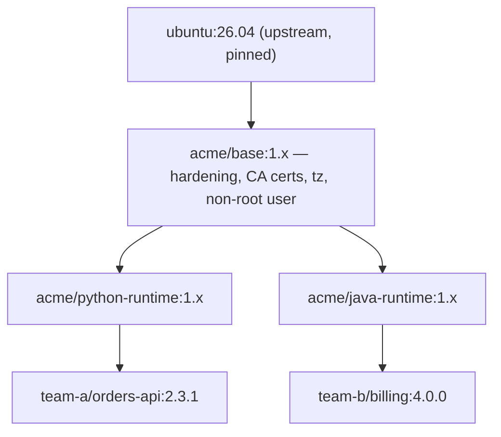

# Project 06 — Internal Base-Image Factory & Image Promotion SOP

| | |
|---|---|
| **Module** | 3 — Docker I |
| **Level** | L2 — Engineer |
| **Role you play** | Platform Engineer owning the organisation's container base images |
| **Scope** | `Dockerfile.md`, `Docker-commands.md`, `Docker-push.md`, `Docker-commit.md` |

---

## 1. Business problem

Every team writes `FROM ubuntu:latest` and reinstalls the same packages, sets a different
timezone, runs everything as root, and ships images 1.2 GB in size. There is no way to answer
*"which images contain the vulnerable library?"* because no two images are built the same way.

The Platform team (you) must deliver an **internal base-image factory**: a small set of golden
base images that application teams build `FROM`, plus the **promotion SOP** that moves an image
from `dev` → `staging` → `prod` without rebuilding it.

## 2. Objectives

1. Build a hardened, non-root, labelled **organisation base image** on `ubuntu:26.04`.
2. Build a **language runtime image** on top of it.
3. Build a **sample application image** on top of that, proving the inheritance chain.
4. Implement **image promotion by re-tagging**, never by rebuilding.
5. Produce an inventory/trace procedure that answers "where is this base image used?".

## 3. Scope

**In scope:** Dockerfile instructions including `ARG`, `ENV`, `USER`, `WORKDIR`, `COPY`,
`RUN`, `ENTRYPOINT`, `CMD`, `LABEL`, `HEALTHCHECK`; `docker build --build-arg`, `history`,
`inspect`, `tag`, `push`, `pull`, `rmi`, `system prune`.

**Out of scope:** Compose/Swarm (Module 4), CI automation (Module 8), image signing.

---

## 4. Standard Operating Procedure (SOP)

> **SOP ID:** PLT-SOP-006 · **Title:** Base image build, versioning and promotion

### 4.1 Image hierarchy



### 4.2 Base image rules (non-negotiable)

| # | Rule | Reason |
|---|---|---|
| 1 | Pin the upstream tag (`ubuntu:26.04`), never `latest` | Reproducibility |
| 2 | Non-root `USER` by default | Blast-radius reduction |
| 3 | No shells/compilers that the runtime does not need | Attack surface |
| 4 | OCI labels on every image | Traceability/inventory |
| 5 | Single cleaned `RUN` layer for packages | Image size |
| 6 | `DEBIAN_FRONTEND=noninteractive` | Deterministic builds |
| 7 | No secrets, ever — they persist in layers | Security |
| 8 | Base images are rebuilt **monthly** for patches, bumping the minor version | CVE hygiene |

### 4.3 Promotion flow — **build once, promote by tag**

| Stage | Tag | Gate |
|---|---|---|
| Build | `acme/base:1.0.0-rc1` | Build succeeds, size budget met |
| Dev | `acme/base:dev` | Smoke test passes |
| Staging | `acme/base:staging` | Consumer images rebuild successfully |
| Prod | `acme/base:1.0.0` + `acme/base:prod` | Platform lead approval |

> The **same image digest** carries all the way through. If you rebuild between stages you have
> tested a different artefact than the one you shipped.

### 4.4 Change/rollback

* Rollback = repoint `acme/base:prod` to the previous version tag and notify consumers.
* Breaking changes (OS major, user/UID change, removed package) require a **major** version bump
  and a 30-day consumer migration window.

---

## 5. Hands-on implementation

### Step 1 — The organisation base image

```bash
mkdir -p ~/image-factory/base && cd ~/image-factory/base
```

```bash
cat > Dockerfile <<'EOF'
FROM ubuntu:26.04

ARG BUILD_DATE
ARG BASE_VERSION=1.0.0

LABEL org.opencontainers.image.title="acme-base" \
      org.opencontainers.image.version="${BASE_VERSION}" \
      org.opencontainers.image.created="${BUILD_DATE}" \
      org.opencontainers.image.vendor="ACME Platform Engineering" \
      org.opencontainers.image.base.name="ubuntu:26.04" \
      org.opencontainers.image.source="https://github.com/<you>/image-factory"

ENV DEBIAN_FRONTEND=noninteractive \
    TZ=Asia/Kolkata \
    LANG=C.UTF-8 \
    APP_HOME=/opt/app

# One cleaned layer: CA certs, timezone, minimal tooling
RUN apt-get update && \
    apt-get install -y --no-install-recommends \
        ca-certificates tzdata curl && \
    ln -snf /usr/share/zoneinfo/$TZ /etc/localtime && \
    echo $TZ > /etc/timezone && \
    apt-get purge -y --auto-remove && \
    apt-get clean && \
    rm -rf /var/lib/apt/lists/* /tmp/* /var/tmp/*

# Fixed UID/GID so volume permissions are predictable across hosts
RUN groupadd -g 10001 appgroup && \
    useradd  -u 10001 -g appgroup -m -s /usr/sbin/nologin appuser && \
    mkdir -p ${APP_HOME} && \
    chown -R appuser:appgroup ${APP_HOME}

WORKDIR ${APP_HOME}
USER appuser

CMD ["/bin/bash"]
EOF
```

```bash
docker build \
  --build-arg BUILD_DATE="$(date -u +%Y-%m-%dT%H:%M:%SZ)" \
  --build-arg BASE_VERSION=1.0.0 \
  -t acme/base:1.0.0-rc1 .

docker images acme/base
docker history acme/base:1.0.0-rc1
docker inspect acme/base:1.0.0-rc1 | jq '.[0].Config | {User, Env, Labels}'
```

**Verify the hardening claims:**

```bash
docker run --rm acme/base:1.0.0-rc1 id           # uid=10001 appuser, NOT root
docker run --rm acme/base:1.0.0-rc1 date         # timezone applied
docker run --rm acme/base:1.0.0-rc1 \
  sh -c 'curl -sI https://www.google.com | head -1'   # CA certs work
docker run --rm acme/base:1.0.0-rc1 \
  sh -c 'touch /etc/test 2>&1 || echo "write to /etc correctly denied"'
```

### Step 2 — Runtime image on top of the base

```bash
mkdir -p ~/image-factory/python-runtime && cd ~/image-factory/python-runtime
```

```bash
cat > Dockerfile <<'EOF'
FROM acme/base:1.0.0-rc1

ARG RUNTIME_VERSION=1.0.0
LABEL org.opencontainers.image.title="acme-python-runtime" \
      org.opencontainers.image.version="${RUNTIME_VERSION}" \
      org.opencontainers.image.base.name="acme/base:1.0.0"

# Package installs need root; drop back to appuser immediately after
USER root
RUN apt-get update && \
    apt-get install -y --no-install-recommends python3 python3-venv && \
    apt-get clean && rm -rf /var/lib/apt/lists/*
USER appuser

ENV VIRTUAL_ENV=${APP_HOME}/venv \
    PATH=${APP_HOME}/venv/bin:$PATH
RUN python3 -m venv ${VIRTUAL_ENV}

CMD ["python3"]
EOF
```

```bash
docker build -t acme/python-runtime:1.0.0-rc1 .
docker run --rm acme/python-runtime:1.0.0-rc1 python3 --version
docker run --rm acme/python-runtime:1.0.0-rc1 id      # still non-root
```

> **Job insight:** `USER root` → install → `USER appuser` is the standard pattern. Forgetting to
> drop back is one of the most common findings in a container security review.

### Step 3 — Application image proving the chain

```bash
mkdir -p ~/image-factory/sample-app && cd ~/image-factory/sample-app

cat > app.py <<'EOF'
import http.server, socketserver, os
PORT = int(os.environ.get("PORT", "8080"))
class H(http.server.SimpleHTTPRequestHandler):
    def do_GET(self):
        self.send_response(200); self.send_header("Content-Type","text/plain"); self.end_headers()
        self.wfile.write(b"orders-api OK\n")
print(f"listening on {PORT}", flush=True)
socketserver.TCPServer(("", PORT), H).serve_forever()
EOF
```

```bash
cat > Dockerfile <<'EOF'
FROM acme/python-runtime:1.0.0-rc1

LABEL org.opencontainers.image.title="orders-api" \
      org.opencontainers.image.version="2.3.1"

ENV PORT=8080
COPY --chown=appuser:appgroup app.py ${APP_HOME}/app.py

EXPOSE 8080
HEALTHCHECK --interval=15s --timeout=3s --retries=3 \
  CMD curl -fsS http://localhost:8080/ || exit 1

ENTRYPOINT ["python3"]
CMD ["/opt/app/app.py"]
EOF

docker build -t team-a/orders-api:2.3.1 .
docker run -d --name orders -p 8080:8080 team-a/orders-api:2.3.1
sleep 5
curl -s http://localhost:8080
docker inspect --format '{{.State.Health.Status}}' orders
docker exec orders id          # non-root inherited all the way down
```

### Step 4 — Promotion by re-tagging (never rebuild)

```bash
DH_USER=<your-dockerhub-user>
docker login

# Record the digest - this is the real identity of the artefact
docker tag acme/base:1.0.0-rc1 $DH_USER/acme-base:1.0.0-rc1
docker push $DH_USER/acme-base:1.0.0-rc1
docker inspect --format '{{index .RepoDigests 0}}' $DH_USER/acme-base:1.0.0-rc1

# dev gate passed -> promote
docker tag $DH_USER/acme-base:1.0.0-rc1 $DH_USER/acme-base:dev
docker push $DH_USER/acme-base:dev

# staging gate passed -> promote
docker tag $DH_USER/acme-base:1.0.0-rc1 $DH_USER/acme-base:staging
docker push $DH_USER/acme-base:staging

# prod approval -> release
docker tag $DH_USER/acme-base:1.0.0-rc1 $DH_USER/acme-base:1.0.0
docker tag $DH_USER/acme-base:1.0.0-rc1 $DH_USER/acme-base:prod
docker push $DH_USER/acme-base:1.0.0
docker push $DH_USER/acme-base:prod
```

**Prove the promotion did not change the artefact:**

```bash
for t in 1.0.0-rc1 dev staging 1.0.0 prod; do
  echo -n "$t -> "; docker inspect --format '{{.Id}}' $DH_USER/acme-base:$t
done
# All five must print the SAME image ID.
```

### Step 5 — Monthly patch rebuild (1.0.0 → 1.0.1)

```bash
cd ~/image-factory/base
docker build --no-cache \
  --build-arg BUILD_DATE="$(date -u +%Y-%m-%dT%H:%M:%SZ)" \
  --build-arg BASE_VERSION=1.0.1 \
  -t acme/base:1.0.1 .

docker images acme/base
# Consumers rebuild against 1.0.1, retest, then prod tag moves.
```

### Step 6 — Inventory: "which images use our base?"

```bash
# Which local images descend from the base layer set
docker images --format '{{.Repository}}:{{.Tag}}' | while read -r img; do
  base=$(docker inspect --format '{{index .Config.Labels "org.opencontainers.image.base.name"}}' "$img" 2>/dev/null)
  [ -n "$base" ] && [ "$base" != "<no value>" ] && echo "$img  <-  $base"
done

# Full layer/size accounting
docker system df -v | head -30
docker image inspect team-a/orders-api:2.3.1 --format '{{json .RootFS.Layers}}' | jq .
```

---

## 6. Acceptance criteria

- [ ] Base image runs as UID 10001, not root
- [ ] All three images carry OCI labels including `base.name`
- [ ] Base image size is documented and justified (compare against `ubuntu:26.04`)
- [ ] `docker history` shows no secrets and no stray apt cache layer
- [ ] All five promotion tags resolve to the **same image ID**
- [ ] Application image reports `healthy` and serves traffic as non-root
- [ ] Inventory command lists the parent base for each image

---

## 7. Troubleshooting

| Symptom | Cause | Action |
|---|---|---|
| `Permission denied` writing in the container | Non-root default `USER` | `COPY --chown=appuser:appgroup`, or write only under `$APP_HOME` |
| `apt-get install` fails in child image | Still running as `appuser` | `USER root` → install → `USER appuser` |
| Promotion tags have different image IDs | Someone rebuilt instead of re-tagging | Rebuild discipline; promote with `docker tag` only |
| Image much larger than expected | apt lists/cache kept, multiple `RUN` layers | Chain commands, `apt-get clean`, `rm -rf /var/lib/apt/lists/*` |
| Volume files owned by the wrong UID on the host | UID mismatch between host and image | Fixed UID/GID (10001) in the base image |
| `docker build` ignores a change | Layer cache | `--no-cache`, or order `COPY` of changing files last |
| `<no value>` from `docker inspect` label | Label not set on that image | Add the `LABEL` to the Dockerfile |

---

## 8. Cleanup

```bash
docker rm -f orders 2>/dev/null
docker rmi team-a/orders-api:2.3.1 acme/python-runtime:1.0.0-rc1 \
           acme/base:1.0.0-rc1 acme/base:1.0.1 2>/dev/null
docker system prune -af
```

---

## 9. Deliverables

1. `image-factory/` repo with `base/`, `python-runtime/`, `sample-app/` Dockerfiles.
2. `BASE-IMAGE-STANDARD.md` — the 8 rules, hierarchy diagram, versioning policy.
3. `PROMOTION-SOP.md` — stage/tag/gate table and the digest-equality proof command.
4. Evidence that all promotion tags share one image ID.
5. Size comparison table: `ubuntu:26.04` vs `acme/base` vs runtime vs app.

---

## 10. Interview talking points

* *"Why a company base image?"* — One place to patch CVEs, enforce non-root and labels, and a
  single inventory point for "which apps are affected".
* *"What does 'build once, promote by tag' mean?"* — The artefact tested in staging is bit-for-bit
  the artefact released to prod; rebuilding between stages invalidates your testing.
* *"How do you keep containers from running as root?"* — Create a fixed UID/GID user in the base,
  `USER` directive, `COPY --chown`, and only elevate to root for install steps.
* *"A CVE drops in the base OS — what happens?"* — Rebuild base with a patch version bump,
  rebuild consumers, retest, move the `prod` tag; use labels to find every affected image.
* *"Why fixed UID 10001?"* — Host bind-mount permissions become predictable across machines.

**CV bullet:** *Designed and operated an internal container base-image factory (hardened,
non-root, OCI-labelled Ubuntu 26.04 base plus language runtimes) with a build-once/promote-by-tag
release SOP, giving the platform a single point for CVE patching and image inventory.*
