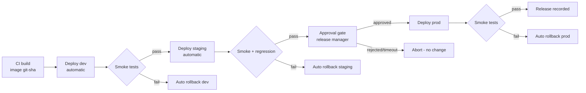

# Project 16 — CD Pipeline with Approval Gate and Automated Rollback

| | |
|---|---|
| **Module** | 8 — Jenkins |
| **Level** | L3 — Senior |
| **Role you play** | DevOps Engineer owning the release pipeline and the deployment change process |
| **Scope** | `Jenkins-hands-on.md` + the CI pipeline from Project 15 |

---

## 1. Business problem

CI produces trustworthy images (Project 15), but deployment is still a human SSH-ing into servers
at 10 pm with a checklist. Releases are inconsistent, there is no approval record for auditors,
and rolling back means finding whoever remembers the last good version.

Deliver a **continuous delivery pipeline**: promote the already-built image through dev → staging
→ production, require a **human approval** before production, verify with automated smoke tests,
and **roll back automatically** if the verification fails.

## 2. Objectives

1. Build a deployment pipeline that consumes the image produced by CI — **never rebuilds**.
2. Implement an `input` approval gate with a timeout and a recorded approver.
3. Deploy to each environment and verify with real health checks.
4. Implement automatic rollback to the previous image on verification failure.
5. Produce an auditable record: who approved, what version, when, and the outcome.

## 3. Scope

**In scope:** declarative pipeline, `input` with `submitter`, `milestone`, `lock`, `stash/unstash`,
`when` conditions, `post` blocks, `build job:` triggering, parameters, `credentials`,
SSH deployment via `sshagent`/`withCredentials`, environment-specific config, Jenkins views.

**Out of scope:** Kubernetes deployment (Module 9 covers the cluster), blue/green at the load
balancer, feature flags, canary analysis tooling.

---

## 4. Standard Operating Procedure (SOP)

> **SOP ID:** CD-SOP-016 · **Title:** Promote and release a service to production

### 4.1 Promotion path



### 4.2 Rules

1. **Build once.** The artefact deployed to production is the exact image tested in staging.
2. **No deploy without a green CI build** for that commit.
3. **Production requires explicit human approval** by a named submitter group, with a timeout.
4. **Record the previous image before deploying** — that is the rollback target.
5. **Verification is automated and is the gate.** "It looked fine" is not a verification.
6. **Concurrency is locked per environment** — two deployments must never overlap.
7. **Every production deployment produces an audit record.**
8. Rollback is automatic on verification failure and must itself be verified.

### 4.3 Approval record (captured automatically)

| Field | Source |
|---|---|
| Release version | image tag `git-<sha>` |
| Requested by | build cause / commit author |
| Approved by | `input` submitter |
| Approved at | build timestamp |
| Change ticket | pipeline parameter |
| Result | post-deploy verification outcome |

### 4.4 Abort criteria
Abort the release (and roll back) if: health check fails after the retry budget, error rate rises
above threshold during the verification window, or the approver does not respond within the
timeout.

---

## 5. Hands-on implementation

### Step 1 — Deployment targets

Three Ubuntu 26.04 VMs with Docker CE installed (Module 3 block) and a `deployer` user:

```bash
# On each target: dev-1, stg-1, prod-1
sudo useradd -m -s /bin/bash deployer
sudo usermod -aG docker deployer
sudo mkdir -p /home/deployer/.ssh && sudo chmod 700 /home/deployer/.ssh
# paste the Jenkins deploy public key:
sudo tee /home/deployer/.ssh/authorized_keys < /dev/stdin
sudo chown -R deployer:deployer /home/deployer/.ssh
sudo chmod 600 /home/deployer/.ssh/authorized_keys
```

In Jenkins add credentials:

| ID | Type | Use |
|---|---|---|
| `deploy-ssh-key` | SSH username with private key (`deployer`) | Deploy to targets |
| `dockerhub-creds` | Username/password (token) | Pull images on targets |

### Step 2 — The deployment script (lives in the repo, not in Jenkins)

`deploy/deploy.sh`:

```bash
#!/usr/bin/env bash
# Deploy one image version to this host. Idempotent and rollback-friendly.
set -euo pipefail

IMAGE="${1:?usage: deploy.sh <image:tag> <app-name> <port>}"
APP="${2:?}"
PORT="${3:?}"

echo "[deploy] pulling ${IMAGE}"
docker pull "${IMAGE}"

# Record the currently running image so we can roll back
PREV=$(docker inspect --format '{{.Config.Image}}' "${APP}" 2>/dev/null || echo "none")
echo "[deploy] previous image: ${PREV}"
echo "${PREV}" > "/home/deployer/${APP}.previous"

echo "[deploy] replacing container"
docker rm -f "${APP}" 2>/dev/null || true
docker run -d \
  --name "${APP}" \
  --restart unless-stopped \
  -p "${PORT}:8080" \
  --health-cmd 'curl -fsS http://localhost:8080/health || exit 1' \
  --health-interval 10s \
  --health-retries 5 \
  "${IMAGE}"

echo "[deploy] started ${APP} from ${IMAGE}"
docker ps --filter "name=${APP}"
```

`deploy/verify.sh`:

```bash
#!/usr/bin/env bash
# Verification gate: the deployment is only successful if this passes.
set -euo pipefail

URL="${1:?usage: verify.sh <url> [retries] [delay]}"
RETRIES="${2:-20}"
DELAY="${3:-5}"

echo "[verify] probing ${URL}"
for i in $(seq 1 "${RETRIES}"); do
  CODE=$(curl -s -o /dev/null -w '%{http_code}' --max-time 5 "${URL}" || echo "000")
  if [ "${CODE}" = "200" ]; then
    echo "[verify] attempt ${i}: HTTP 200 - PASS"
    # Sustained check: must stay healthy, not just flicker green once
    FAILS=0
    for j in $(seq 1 10); do
      C=$(curl -s -o /dev/null -w '%{http_code}' --max-time 5 "${URL}" || echo "000")
      [ "${C}" = "200" ] || FAILS=$((FAILS+1))
      sleep 2
    done
    if [ "${FAILS}" -eq 0 ]; then
      echo "[verify] sustained check PASSED"
      exit 0
    fi
    echo "[verify] sustained check FAILED (${FAILS}/10 errors)"
    exit 1
  fi
  echo "[verify] attempt ${i}: HTTP ${CODE} - retrying"
  sleep "${DELAY}"
done

echo "[verify] FAILED after ${RETRIES} attempts"
exit 1
```

`deploy/rollback.sh`:

```bash
#!/usr/bin/env bash
set -euo pipefail
APP="${1:?usage: rollback.sh <app-name> <port>}"
PORT="${2:?}"

PREV_FILE="/home/deployer/${APP}.previous"
[ -f "${PREV_FILE}" ] || { echo "[rollback] no previous image recorded"; exit 1; }
PREV=$(cat "${PREV_FILE}")
[ "${PREV}" != "none" ] || { echo "[rollback] first deployment - nothing to roll back to"; exit 1; }

echo "[rollback] restoring ${PREV}"
docker rm -f "${APP}" 2>/dev/null || true
docker run -d --name "${APP}" --restart unless-stopped -p "${PORT}:8080" "${PREV}"
docker ps --filter "name=${APP}"
echo "[rollback] complete"
```

```bash
chmod +x deploy/*.sh
```

### Step 3 — The CD `Jenkinsfile`

`Jenkinsfile.cd`:

```groovy
pipeline {
    agent { label 'linux && docker' }

    options {
        timeout(time: 2, unit: 'HOURS')
        buildDiscarder(logRotator(numToKeepStr: '50'))
        timestamps()
        disableConcurrentBuilds()
    }

    parameters {
        string(name: 'IMAGE_TAG', defaultValue: '',
               description: 'Image tag from CI, e.g. git-a1b2c3d (required)')
        string(name: 'CHANGE_TICKET', defaultValue: '',
               description: 'Change ticket reference for the audit record')
        booleanParam(name: 'SKIP_PROD', defaultValue: false,
               description: 'Stop after staging')
    }

    environment {
        IMAGE_NAME = 'acmedevops/orders-api'
        APP_NAME   = 'orders-api'
        DEV_HOST   = 'deployer@10.128.0.41'
        STG_HOST   = 'deployer@10.128.0.42'
        PRD_HOST   = 'deployer@10.128.0.43'
        APP_PORT   = '8080'
    }

    stages {

        stage('Validate request') {
            steps {
                script {
                    if (!params.IMAGE_TAG?.trim()) {
                        error('IMAGE_TAG is required - this pipeline deploys, it does not build.')
                    }
                    env.FULL_IMAGE = "${env.IMAGE_NAME}:${params.IMAGE_TAG}"
                    currentBuild.displayName = "#${env.BUILD_NUMBER} ${params.IMAGE_TAG}"
                    currentBuild.description = "ticket ${params.CHANGE_TICKET ?: 'none'}"
                }

                withCredentials([usernamePassword(credentialsId: 'dockerhub-creds',
                                                  usernameVariable: 'DH_USER',
                                                  passwordVariable: 'DH_TOKEN')]) {
                    sh '''
                      echo "$DH_TOKEN" | docker login -u "$DH_USER" --password-stdin
                      echo "Verifying the artefact exists in the registry..."
                      docker manifest inspect ${FULL_IMAGE} > /dev/null
                      docker logout
                      echo "Artefact ${FULL_IMAGE} confirmed"
                    '''
                }
                checkout scm
                stash name: 'deploy-scripts', includes: 'deploy/*.sh'
            }
        }

        stage('Deploy DEV') {
            options { lock(resource: 'env-dev') }
            steps {
                milestone(ordinal: 10, label: 'dev')
                unstash 'deploy-scripts'
                deployTo(env.DEV_HOST, env.FULL_IMAGE, env.APP_NAME, env.APP_PORT)
            }
            post {
                failure { rollbackOn(env.DEV_HOST, env.APP_NAME, env.APP_PORT, 'DEV') }
            }
        }

        stage('Verify DEV') {
            steps {
                sshagent(['deploy-ssh-key']) {
                    sh '''
                      ssh -o StrictHostKeyChecking=no ${DEV_HOST} \
                        "bash -s" -- < deploy/verify.sh http://localhost:${APP_PORT}/health 20 5
                    '''
                }
            }
            post {
                failure { rollbackOn(env.DEV_HOST, env.APP_NAME, env.APP_PORT, 'DEV') }
            }
        }

        stage('Deploy STAGING') {
            options { lock(resource: 'env-staging') }
            steps {
                milestone(ordinal: 20, label: 'staging')
                deployTo(env.STG_HOST, env.FULL_IMAGE, env.APP_NAME, env.APP_PORT)
            }
            post {
                failure { rollbackOn(env.STG_HOST, env.APP_NAME, env.APP_PORT, 'STAGING') }
            }
        }

        stage('Verify STAGING') {
            parallel {
                stage('Health check') {
                    steps {
                        sshagent(['deploy-ssh-key']) {
                            sh '''
                              ssh -o StrictHostKeyChecking=no ${STG_HOST} \
                                "bash -s" -- < deploy/verify.sh http://localhost:${APP_PORT}/health 20 5
                            '''
                        }
                    }
                }
                stage('Regression pack') {
                    steps {
                        sh '''
                          mvn -B -f ui-tests/pom.xml clean test -Pci \
                            -Dheadless=true -DbaseUrl=http://10.128.0.42:8080
                        '''
                    }
                    post {
                        always {
                            junit allowEmptyResults: true,
                                  testResults: 'ui-tests/target/surefire-reports/*.xml'
                            archiveArtifacts artifacts: 'ui-tests/target/screenshots/**',
                                             allowEmptyArchive: true
                        }
                    }
                }
            }
            post {
                failure { rollbackOn(env.STG_HOST, env.APP_NAME, env.APP_PORT, 'STAGING') }
            }
        }

        stage('Production approval') {
            when { expression { return !params.SKIP_PROD } }
            options { timeout(time: 60, unit: 'MINUTES') }
            steps {
                script {
                    def approval = input(
                        id: 'prodApproval',
                        message: "Release ${params.IMAGE_TAG} to PRODUCTION?",
                        ok: 'Approve release',
                        submitter: 'release-managers,devops-leads',
                        submitterParameter: 'APPROVER',
                        parameters: [
                            choice(name: 'CONFIRM', choices: ['no', 'yes'],
                                   description: 'Confirm staging verification was reviewed'),
                            string(name: 'NOTES', defaultValue: '',
                                   description: 'Approval notes / risk assessment')
                        ]
                    )
                    if (approval.CONFIRM != 'yes') {
                        error('Approver did not confirm staging review - release aborted.')
                    }
                    env.APPROVER       = approval.APPROVER
                    env.APPROVAL_NOTES = approval.NOTES
                    env.APPROVED_AT    = new Date().format("yyyy-MM-dd'T'HH:mm:ssZ")
                    echo "Approved by ${env.APPROVER} at ${env.APPROVED_AT}"
                }
            }
        }

        stage('Deploy PRODUCTION') {
            when { expression { return !params.SKIP_PROD } }
            options { lock(resource: 'env-production') }
            steps {
                milestone(ordinal: 30, label: 'production')
                deployTo(env.PRD_HOST, env.FULL_IMAGE, env.APP_NAME, env.APP_PORT)
            }
            post {
                failure { rollbackOn(env.PRD_HOST, env.APP_NAME, env.APP_PORT, 'PRODUCTION') }
            }
        }

        stage('Verify PRODUCTION') {
            when { expression { return !params.SKIP_PROD } }
            steps {
                sshagent(['deploy-ssh-key']) {
                    sh '''
                      ssh -o StrictHostKeyChecking=no ${PRD_HOST} \
                        "bash -s" -- < deploy/verify.sh http://localhost:${APP_PORT}/health 30 5
                    '''
                }
            }
            post {
                failure {
                    rollbackOn(env.PRD_HOST, env.APP_NAME, env.APP_PORT, 'PRODUCTION')
                    error('PRODUCTION verification failed - automatic rollback executed.')
                }
            }
        }

        stage('Record the release') {
            when { expression { return !params.SKIP_PROD } }
            steps {
                script {
                    def record = """
RELEASE RECORD
==============
Service        : ${env.APP_NAME}
Version        : ${params.IMAGE_TAG}
Image          : ${env.FULL_IMAGE}
Change ticket  : ${params.CHANGE_TICKET ?: 'NONE'}
Build          : #${env.BUILD_NUMBER} (${env.BUILD_URL})
Approved by    : ${env.APPROVER}
Approved at    : ${env.APPROVED_AT}
Approval notes : ${env.APPROVAL_NOTES ?: '-'}
Deployed at    : ${new Date().format("yyyy-MM-dd'T'HH:mm:ssZ")}
Verification   : PASSED
"""
                    writeFile file: 'release-record.txt', text: record
                    echo record
                }
                archiveArtifacts artifacts: 'release-record.txt', fingerprint: true
            }
        }
    }

    post {
        success { echo "RELEASE SUCCESSFUL: ${env.FULL_IMAGE}" }
        aborted { echo "RELEASE ABORTED (approval timeout or rejection) - no production change" }
        failure { echo "RELEASE FAILED - check whether rollback completed successfully" }
        always  { cleanWs(notFailBuild: true) }
    }
}

// ---- helper methods -------------------------------------------------------

void deployTo(String host, String image, String app, String port) {
    sshagent(['deploy-ssh-key']) {
        sh """
          ssh -o StrictHostKeyChecking=no ${host} "bash -s" -- \
            < deploy/deploy.sh ${image} ${app} ${port}
        """
    }
}

void rollbackOn(String host, String app, String port, String envName) {
    echo "!!! ${envName} deployment/verification failed - rolling back"
    sshagent(['deploy-ssh-key']) {
        sh """
          ssh -o StrictHostKeyChecking=no ${host} "bash -s" -- \
            < deploy/rollback.sh ${app} ${port} || echo 'rollback script reported an error'
        """
        sh """
          ssh -o StrictHostKeyChecking=no ${host} "bash -s" -- \
            < deploy/verify.sh http://localhost:${port}/health 15 4 \
            || echo 'WARNING: rollback did not verify - MANUAL INTERVENTION REQUIRED'
        """
    }
}
```

> Note: `deploy.sh` is piped to `bash -s` with arguments, so the scripts stay in Git and nothing
> is copied to the targets permanently.

### Step 4 — Chain CI → CD

Add to the **CI** `Jenkinsfile` (Project 15), after a successful push:

```groovy
stage('Trigger CD') {
    when { branch 'main' }
    steps {
        build job: 'orders-api-cd',
              parameters: [
                  string(name: 'IMAGE_TAG',     value: env.IMAGE_TAG),
                  string(name: 'CHANGE_TICKET', value: env.CHANGE_TICKET ?: '')
              ],
              wait: false
    }
}
```

### Step 5 — Drill A: happy path

```bash
# Push to main -> CI builds and pushes git-<sha> -> CD starts automatically
```

Watch the CD pipeline:
* DEV deploy + verify pass,
* STAGING deploy + verify + regression pass,
* pipeline **pauses** at *Production approval*,
* approve as a user in `release-managers`,
* PROD deploy + verify pass,
* `release-record.txt` archived.

### Step 6 — Drill B: automatic rollback

Build an intentionally broken image whose `/health` returns 500, push it as
`git-broken1`, then run the CD job with `IMAGE_TAG=git-broken1`.

Expected:
* DEV deploy succeeds (the container starts),
* **Verify DEV fails**,
* rollback runs, the previous image is restored,
* rollback verification passes,
* pipeline fails — **staging and production are never touched**.

```bash
# Confirm on the dev host
ssh deployer@10.128.0.41 'docker inspect --format "{{.Config.Image}}" orders-api'
# must show the PREVIOUS good tag
```

### Step 7 — Drill C: approval behaviour

1. Run the job and **do not approve**. After 60 minutes the stage times out and the build is
   `ABORTED` — production is unchanged.
2. Run again and have a user **not** in `release-managers` attempt to approve — Jenkins refuses.
3. Approve with `CONFIRM = no` — the pipeline errors out by design.

### Step 8 — Drill D: concurrency lock

Start two CD builds for different tags simultaneously. The second must **wait** at
`lock(resource: 'env-production')` rather than deploying on top of the first.

---

## 6. Acceptance criteria

- [ ] CD pipeline never builds an image — it only promotes an existing tag
- [ ] Pipeline refuses to run without `IMAGE_TAG`, and verifies the tag exists in the registry
- [ ] Production requires approval from a restricted submitter group, with a timeout
- [ ] Approver identity, timestamp and notes are captured in an archived release record
- [ ] Verification is a **sustained** health check, not a single 200
- [ ] Failed verification triggers automatic rollback, and the rollback is itself verified
- [ ] Failure in dev/staging stops the pipeline — later environments untouched
- [ ] Environments are locked so concurrent deployments cannot overlap
- [ ] All four drills executed with evidence

---

## 7. Troubleshooting

| Symptom | Cause | Action |
|---|---|---|
| `Host key verification failed` | Unknown host key on the agent | `-o StrictHostKeyChecking=no` for lab, or pre-populate `known_hosts` properly |
| `Permission denied (publickey)` | Wrong credential or key not installed on the target | Verify `deploy-ssh-key` and `authorized_keys` |
| Rollback says "no previous image" | First deployment on that host | Expected; document it. Keep a known-good tag as a fallback parameter |
| Approval step never appears | `when` excluded it, or no one has the submitter role | Check `SKIP_PROD` and the submitter group names |
| Anyone can approve | `submitter` not set | Set `submitter` and matrix-based security |
| Two builds deployed at once | Missing `lock`/`disableConcurrentBuilds` | Add `options { lock(...) }` per environment |
| Health check passes then the app dies | Single-shot probe | Sustained verification loop (implemented in `verify.sh`) |
| `docker manifest inspect` fails | Not logged in, or tag doesn't exist | Confirm CI pushed; check credentials |
| Old build overwrites a newer release | Out-of-order builds | `milestone()` discards superseded builds |

---

## 8. Cleanup

```bash
for h in 10.128.0.41 10.128.0.42 10.128.0.43; do
  ssh deployer@$h 'docker rm -f orders-api 2>/dev/null; docker image prune -af'
done
gcloud compute instances delete dev-1 stg-1 prod-1 --zone <zone>
```

---

## 9. Deliverables

1. `Jenkinsfile.cd` plus `deploy/deploy.sh`, `verify.sh`, `rollback.sh` in the repo.
2. `CD-SOP-016.md` — promotion diagram, rules, approval record fields, abort criteria.
3. Archived `release-record.txt` from a real approved release.
4. Evidence of all four drills (happy path, auto-rollback, approval timeout/rejection, lock).
5. Screenshot of the pipeline stage view paused at the approval gate.

---

## 10. Interview talking points

* *"How does your release process work?"* — CI builds once; CD promotes that exact image through
  dev → staging → prod with automated verification and a human approval gate before production.
* *"What happens if a deployment breaks production?"* — Verification fails, the pipeline rolls
  back to the previously recorded image automatically and then verifies the rollback; the build
  fails loudly so nobody thinks it succeeded.
* *"How do you satisfy an auditor?"* — The archived release record: version, change ticket,
  approver identity, timestamp, notes and verification outcome, all generated by the pipeline.
* *"Why `lock` and `milestone`?"* — `lock` prevents two deployments colliding in one environment;
  `milestone` prevents an older build overtaking a newer one.
* *"Why not rebuild per environment?"* — Then production runs an artefact that was never tested.
  Build once, promote the digest.
* *"What is the weakness of this design?"* — Single-instance deploys mean brief downtime per host;
  the next step is rolling updates behind a load balancer (Swarm/Kubernetes) and canary analysis.

**CV bullet:** *Designed and implemented a Jenkins continuous delivery pipeline promoting a single
immutable artefact through dev/staging/production with environment locking, gated human approval,
sustained health verification, automatic verified rollback and auto-generated audit release
records.*
