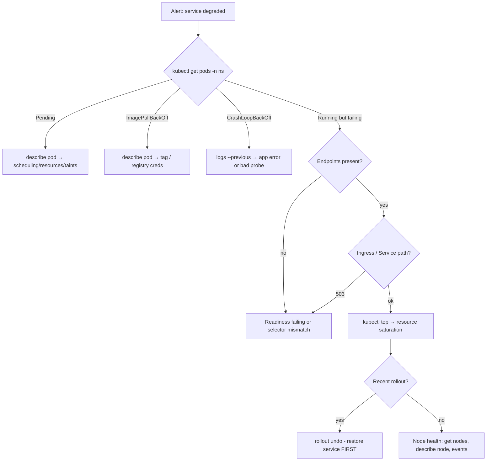

# Project 18 — Day-2 Operations Runbook: Rolling Updates, Probes, Scaling, Incidents

| | |
|---|---|
| **Module** | 9 — Kubernetes |
| **Level** | L3 — Senior |
| **Role you play** | Platform SRE responsible for the cluster after go-live |
| **Scope** | `2-Kubernetes-deployment.md`, `3-Kubernetes-services.md`, `5-Kubernetes-dashboard.md` + Project 17 cluster |

---

## 1. Business problem

The cluster is live (Project 17) and the first incidents have arrived:

* a deployment rolled out a broken image and took the service down for 20 minutes,
* traffic spikes cause timeouts because replica counts are set by hand,
* a pod that was "Running" was actually dead and kept receiving traffic,
* nobody knows what to check first at 2 am.

Produce the **Day-2 operations runbook**: safe rolling updates with instant rollback, correct
health probes, automated scaling, graceful shutdown, resource governance, and a documented
incident triage procedure — all proven by drills.

## 2. Objectives

1. Configure zero-downtime rolling updates and demonstrate `rollout undo`.
2. Add liveness, readiness and startup probes and prove each one's distinct job.
3. Install metrics-server and configure a HorizontalPodAutoscaler; prove it scales.
4. Protect availability with PodDisruptionBudgets and graceful termination.
5. Apply namespace quotas/limits.
6. Install the Kubernetes Dashboard for read-only visibility.
7. Write and rehearse an incident triage runbook.

## 3. Scope

**In scope:** `rollout status/history/undo/restart`, `strategy.rollingUpdate`
(`maxSurge`/`maxUnavailable`), `minReadySeconds`, `revisionHistoryLimit`, probes,
`terminationGracePeriodSeconds`, `preStop`, metrics-server v0.8.0, HPA (`autoscaling/v2`),
PDB, ResourceQuota, LimitRange, `kubectl top/describe/logs/events/exec/port-forward/debug`,
Dashboard 7.x.

**Out of scope:** Prometheus/Grafana alerting (Module 10), CI/CD triggering (Module 8),
cluster upgrades, StatefulSets/storage.

---

## 4. Standard Operating Procedure (SOP)

> **SOP ID:** SRE-SOP-018 · **Title:** Kubernetes day-2 operations and incident response

### 4.1 Change (rollout) procedure

| # | Step |
|---|---|
| 1 | Confirm the image tag exists and came from a green CI build |
| 2 | Record the current revision: `kubectl rollout history deploy/<name>` |
| 3 | Apply the change (`kubectl apply`, never `kubectl edit` in production) |
| 4 | Watch: `kubectl rollout status deploy/<name> --timeout=5m` |
| 5 | If the status times out or errors → `kubectl rollout undo` immediately |
| 6 | Verify endpoints and a real request path after the rollout |
| 7 | Record the outcome in the change ticket |

### 4.2 Probe design rules

| Probe | Question it answers | Failure action | Rule |
|---|---|---|---|
| **startup** | "Has the app finished booting?" | Restart the container | Use for slow starters; disables the others until it passes |
| **readiness** | "Can this pod serve traffic *right now*?" | Remove from Service endpoints | Must check **dependencies** (DB, cache) |
| **liveness** | "Is this process wedged beyond recovery?" | Restart the container | Must be **cheap and local**; never check dependencies |

> Putting a dependency check in liveness causes a cluster-wide restart storm when the dependency
> blips. This is the most common probe mistake in production.

### 4.3 Scaling policy

| Signal | Action |
|---|---|
| CPU sustained > 70 % | HPA scales out |
| CPU sustained < 70 % for the stabilisation window | HPA scales in (slowly) |
| Known event (sale, campaign) | Pre-scale `minReplicas` manually, in advance |
| Pods Pending after scale-out | Cluster is out of capacity → add a node |

Never let an HPA and a manual `kubectl scale` fight: once an HPA owns a Deployment, replicas are
managed by the HPA.

### 4.4 Incident triage order (the 2 am list)



**Golden rule: restore service first, investigate second.** `rollout undo` is the fastest
mitigation for any post-deployment incident.

### 4.5 Evidence to capture before mitigating
`kubectl -n <ns> get pods -o wide`, `describe pod`, `logs --previous`,
`get events --sort-by=.lastTimestamp`, `kubectl top pods`. Capture, then fix.

---

## 5. Hands-on implementation

### Step 1 — A deployment built for safe rollouts

`ops/api-deployment.yaml`:

```yaml
apiVersion: apps/v1
kind: Deployment
metadata:
  name: api
  namespace: shop
  labels: { app: api, tier: backend, env: dev }
  annotations:
    kubernetes.io/change-cause: "v1 baseline"
spec:
  replicas: 4
  revisionHistoryLimit: 10
  minReadySeconds: 10                 # a pod must stay Ready this long before it counts
  progressDeadlineSeconds: 300        # rollout is marked failed after this
  strategy:
    type: RollingUpdate
    rollingUpdate:
      maxSurge: 1                     # one extra pod during the update
      maxUnavailable: 0               # never go below the desired capacity
  selector:
    matchLabels: { app: api }
  template:
    metadata:
      labels: { app: api, tier: backend, env: dev }
    spec:
      terminationGracePeriodSeconds: 45
      containers:
        - name: api
          image: nginx:1.29
          ports:
            - { containerPort: 80, name: http }

          startupProbe:               # slow boot protection
            httpGet: { path: /, port: http }
            failureThreshold: 30
            periodSeconds: 2          # allows up to 60s to start

          readinessProbe:             # controls Service endpoint membership
            httpGet: { path: /, port: http }
            initialDelaySeconds: 2
            periodSeconds: 5
            timeoutSeconds: 2
            failureThreshold: 2
            successThreshold: 1

          livenessProbe:              # cheap, local, no dependencies
            httpGet: { path: /, port: http }
            initialDelaySeconds: 15
            periodSeconds: 10
            timeoutSeconds: 2
            failureThreshold: 3

          lifecycle:
            preStop:
              exec:
                # let the endpoint removal propagate before the process dies
                command: ["sh", "-c", "sleep 10; nginx -s quit"]

          resources:
            requests: { cpu: "100m", memory: "64Mi" }
            limits:   { cpu: "300m", memory: "192Mi" }

          securityContext:
            allowPrivilegeEscalation: false
```

```bash
kubectl apply -f ops/api-deployment.yaml
kubectl -n shop rollout status deploy/api
kubectl -n shop rollout history deploy/api
```

### Step 2 — Drill A: zero-downtime rolling update

Terminal 1 — continuous traffic probe:

```bash
HTTP_NODEPORT=$(kubectl -n ingress-nginx get svc ingress-nginx-controller \
  -o jsonpath='{.spec.ports[?(@.name=="http")].nodePort}')
NODE_IP=<any-node-ip>

OK=0; FAIL=0
while true; do
  if curl -s -o /dev/null -m 2 -H "Host: api.shop.local" \
       "http://${NODE_IP}:${HTTP_NODEPORT}/"; then
    OK=$((OK+1))
  else
    FAIL=$((FAIL+1))
  fi
  printf "\rOK=%d FAIL=%d" "$OK" "$FAIL"
  sleep 0.3
done
```

Terminal 2 — perform the update:

```bash
kubectl -n shop set image deploy/api api=nginx:1.28 \
  --record=false
kubectl -n shop annotate deploy/api kubernetes.io/change-cause="v2 nginx 1.28" --overwrite
kubectl -n shop rollout status deploy/api --timeout=5m
kubectl -n shop get pods -l app=api -w
```

**Expected: `FAIL` stays at 0.** Record the numbers.

Then re-run the same drill with `maxUnavailable: 1, maxSurge: 0` and no `preStop`/`minReadySeconds`
to observe failures appear — that contrast is the point of the drill.

### Step 3 — Drill B: bad deployment and instant rollback

```bash
# Deploy a broken image
kubectl -n shop set image deploy/api api=nginx:does-not-exist
kubectl -n shop annotate deploy/api kubernetes.io/change-cause="v3 BROKEN" --overwrite

kubectl -n shop rollout status deploy/api --timeout=90s   # will NOT succeed
kubectl -n shop get pods -l app=api                       # ImagePullBackOff on the new pod
```

Notice: because `maxUnavailable: 0`, the **old pods are still serving**. Your traffic probe still
shows `FAIL=0`. That is the design working.

```bash
# Mitigate first
kubectl -n shop rollout undo deploy/api
kubectl -n shop rollout status deploy/api
kubectl -n shop rollout history deploy/api

# Roll back to a specific revision
kubectl -n shop rollout history deploy/api --revision=2
kubectl -n shop rollout undo deploy/api --to-revision=2
```

### Step 4 — Drill C: prove what each probe does

Break **readiness** only:

```bash
kubectl -n shop patch deploy/api --type=json -p='[
  {"op":"replace","path":"/spec/template/spec/containers/0/readinessProbe/httpGet/path",
   "value":"/definitely-not-here"}]'

kubectl -n shop get pods -l app=api        # READY 0/1, but NOT restarting
kubectl -n shop get endpoints api-svc      # endpoints drain to empty
curl -s -o /dev/null -w '%{http_code}\n' -H "Host: api.shop.local" \
  "http://${NODE_IP}:${HTTP_NODEPORT}/"    # 503 - Ingress has no healthy backend
```

> Lesson: readiness removes traffic without killing the pod. The pod stays available for debugging.

```bash
kubectl -n shop rollout undo deploy/api
```

Break **liveness** only:

```bash
kubectl -n shop patch deploy/api --type=json -p='[
  {"op":"replace","path":"/spec/template/spec/containers/0/livenessProbe/httpGet/path",
   "value":"/definitely-not-here"}]'

kubectl -n shop get pods -l app=api -w     # RESTARTS climbs, then CrashLoopBackOff
kubectl -n shop describe pod <pod> | grep -A5 Events
```

> Lesson: liveness restarts. A dependency check here would restart every pod during any outage.

```bash
kubectl -n shop rollout undo deploy/api
kubectl -n shop rollout status deploy/api
```

### Step 5 — metrics-server and `kubectl top`

```bash
kubectl apply -f https://github.com/kubernetes-sigs/metrics-server/releases/download/v0.8.0/components.yaml

# Lab clusters with self-signed kubelet certs need this:
kubectl -n kube-system patch deployment metrics-server --type=json -p='[
 {"op":"add","path":"/spec/template/spec/containers/0/args/-","value":"--kubelet-insecure-tls"}]'

kubectl -n kube-system rollout status deploy/metrics-server
sleep 30
kubectl top nodes
kubectl top pods -n shop
```

### Step 6 — HorizontalPodAutoscaler

`ops/api-hpa.yaml`:

```yaml
apiVersion: autoscaling/v2
kind: HorizontalPodAutoscaler
metadata:
  name: api-hpa
  namespace: shop
spec:
  scaleTargetRef:
    apiVersion: apps/v1
    kind: Deployment
    name: api
  minReplicas: 2
  maxReplicas: 10
  metrics:
    - type: Resource
      resource:
        name: cpu
        target:
          type: Utilization
          averageUtilization: 70
    - type: Resource
      resource:
        name: memory
        target:
          type: Utilization
          averageUtilization: 80
  behavior:
    scaleUp:
      stabilizationWindowSeconds: 30      # react quickly
      policies:
        - type: Percent
          value: 100
          periodSeconds: 30
    scaleDown:
      stabilizationWindowSeconds: 300     # shrink slowly - avoid flapping
      policies:
        - type: Pods
          value: 1
          periodSeconds: 60
```

```bash
kubectl apply -f ops/api-hpa.yaml
kubectl -n shop get hpa -w
```

### Step 7 — Drill D: load test and observe autoscaling

```bash
# Generate load from inside the cluster
kubectl -n shop run loadgen --image=busybox:1.36 --restart=Never -- \
  /bin/sh -c 'while true; do wget -q -O- http://api-svc.shop.svc.cluster.local > /dev/null; done'

# Several generators for a real spike
for i in 1 2 3 4 5; do
  kubectl -n shop run loadgen-$i --image=busybox:1.36 --restart=Never -- \
    /bin/sh -c 'while true; do wget -q -O- http://api-svc.shop.svc.cluster.local > /dev/null; done'
done

watch -n 5 'kubectl -n shop get hpa,pods'
kubectl -n shop describe hpa api-hpa | tail -20     # scaling events
```

```bash
# Remove the load and watch the slow scale-in
kubectl -n shop delete pod -l run --ignore-not-found
kubectl -n shop delete pod loadgen loadgen-1 loadgen-2 loadgen-3 loadgen-4 loadgen-5 \
  --ignore-not-found
kubectl -n shop get hpa -w     # scales back after the stabilisation window
```

Record: starting replicas, peak replicas, time to scale out, time to scale in.

### Step 8 — Availability guards: PDB, quota, limits

`ops/guards.yaml`:

```yaml
apiVersion: policy/v1
kind: PodDisruptionBudget
metadata:
  name: api-pdb
  namespace: shop
spec:
  minAvailable: 2          # voluntary disruptions (drain, upgrade) must respect this
  selector:
    matchLabels: { app: api }
---
apiVersion: v1
kind: ResourceQuota
metadata:
  name: shop-quota
  namespace: shop
spec:
  hard:
    requests.cpu: "4"
    requests.memory: 4Gi
    limits.cpu: "8"
    limits.memory: 8Gi
    pods: "40"
---
apiVersion: v1
kind: LimitRange
metadata:
  name: shop-defaults
  namespace: shop
spec:
  limits:
    - type: Container
      default:            { cpu: "200m", memory: "128Mi" }   # applied if not specified
      defaultRequest:     { cpu: "50m",  memory: "64Mi" }
      max:                { cpu: "1",    memory: "1Gi" }
```

```bash
kubectl apply -f ops/guards.yaml
kubectl -n shop describe quota shop-quota
kubectl -n shop get pdb
```

Prove the quota works:

```bash
kubectl -n shop run hog --image=nginx:1.29 \
  --overrides='{"spec":{"containers":[{"name":"hog","image":"nginx:1.29",
  "resources":{"requests":{"cpu":"6"}}}]}}' --restart=Never
# rejected: exceeds quota
```

Prove the PDB works:

```bash
kubectl drain <worker-1> --ignore-daemonsets --delete-emptydir-data
# the drain respects minAvailable: 2 and evicts pods gradually
kubectl -n shop get pods -o wide
kubectl uncordon <worker-1>
```

### Step 9 — Kubernetes Dashboard (7.x via Helm)

```bash
curl -fsSL https://raw.githubusercontent.com/helm/helm/main/scripts/get-helm-3 | bash
helm version

helm repo add kubernetes-dashboard https://kubernetes.github.io/dashboard/
helm repo update
helm upgrade --install kubernetes-dashboard kubernetes-dashboard/kubernetes-dashboard \
  --create-namespace --namespace kubernetes-dashboard

kubectl -n kubernetes-dashboard get pods
```

Create a **read-only** viewer account (least privilege — do not hand out cluster-admin):

`ops/dashboard-viewer.yaml`:

```yaml
apiVersion: v1
kind: ServiceAccount
metadata:
  name: dashboard-viewer
  namespace: kubernetes-dashboard
---
apiVersion: rbac.authorization.k8s.io/v1
kind: ClusterRoleBinding
metadata:
  name: dashboard-viewer
roleRef:
  apiGroup: rbac.authorization.k8s.io
  kind: ClusterRole
  name: view                 # built-in read-only role
subjects:
  - kind: ServiceAccount
    name: dashboard-viewer
    namespace: kubernetes-dashboard
```

```bash
kubectl apply -f ops/dashboard-viewer.yaml
kubectl -n kubernetes-dashboard create token dashboard-viewer --duration=1h

kubectl -n kubernetes-dashboard port-forward svc/kubernetes-dashboard-kong-proxy 8443:443
# browse https://localhost:8443 and paste the token
```

> Access via `port-forward` only — never expose the Dashboard publicly.

### Step 10 — The triage toolkit (practise these until they are muscle memory)

```bash
NS=shop

kubectl -n $NS get pods -o wide
kubectl -n $NS get events --sort-by=.lastTimestamp | tail -30
kubectl -n $NS describe pod <pod>
kubectl -n $NS logs <pod> --tail=100
kubectl -n $NS logs <pod> --previous            # the crashed container's logs
kubectl -n $NS logs -l app=api --tail=20 --prefix
kubectl -n $NS exec -it <pod> -- sh
kubectl -n $NS port-forward <pod> 8080:80       # bypass Service/Ingress to isolate the layer
kubectl -n $NS get endpoints api-svc
kubectl top pods -n $NS
kubectl get nodes
kubectl describe node <node> | grep -A10 "Allocated resources"
kubectl -n $NS debug <pod> -it --image=nicolaka/netshoot --target=api
```

Save as `ops/triage.sh`:

```bash
#!/usr/bin/env bash
# One-shot evidence capture for an incident. Run BEFORE mitigating.
set -uo pipefail
NS="${1:?usage: triage.sh <namespace> [label]}"
SEL="${2:-}"
OUT="triage-${NS}-$(date +%Y%m%d-%H%M%S)"
mkdir -p "$OUT"

kubectl -n "$NS" get all -o wide            > "$OUT/01-all.txt" 2>&1
kubectl -n "$NS" get pods -o yaml           > "$OUT/02-pods.yaml" 2>&1
kubectl -n "$NS" get endpoints              > "$OUT/03-endpoints.txt" 2>&1
kubectl -n "$NS" get events --sort-by=.lastTimestamp > "$OUT/04-events.txt" 2>&1
kubectl -n "$NS" describe pods              > "$OUT/05-describe-pods.txt" 2>&1
kubectl top pods -n "$NS"                   > "$OUT/06-top-pods.txt" 2>&1
kubectl top nodes                           > "$OUT/07-top-nodes.txt" 2>&1
kubectl get nodes -o wide                   > "$OUT/08-nodes.txt" 2>&1
kubectl -n "$NS" get hpa,pdb,quota          > "$OUT/09-guards.txt" 2>&1

if [ -n "$SEL" ]; then
  for p in $(kubectl -n "$NS" get pods -l "$SEL" -o name); do
    name="${p#pod/}"
    kubectl -n "$NS" logs "$name" --tail=300            > "$OUT/log-$name.txt" 2>&1
    kubectl -n "$NS" logs "$name" --previous --tail=300 > "$OUT/log-$name-previous.txt" 2>&1
  done
fi

tar -czf "${OUT}.tar.gz" "$OUT"
echo "Evidence bundle: ${OUT}.tar.gz"
```

```bash
chmod +x ops/triage.sh
./ops/triage.sh shop app=api
```

### Step 11 — Drill E: full incident simulation

Have a colleague (or a script) introduce one fault without telling you:

```bash
# Fault menu - pick one at random
kubectl -n shop set image deploy/api api=nginx:1.99-broken      # 1 bad image
kubectl -n shop patch svc api-svc -p '{"spec":{"selector":{"app":"wrong"}}}'   # 2 selector
kubectl -n shop patch deploy/api --type=json -p='[{"op":"replace",
  "path":"/spec/template/spec/containers/0/resources/limits/memory","value":"8Mi"}]'  # 3 OOM
kubectl -n shop scale deploy/api --replicas=0                   # 4 scaled to zero
```

For each: run `triage.sh`, state the diagnosis from the evidence, mitigate, and time yourself.
Target: **under 5 minutes** from alert to mitigation.

Repair commands:

```bash
kubectl -n shop rollout undo deploy/api
kubectl -n shop patch svc api-svc -p '{"spec":{"selector":{"app":"api"}}}'
kubectl apply -f ops/api-deployment.yaml
```

---

## 6. Acceptance criteria

- [ ] Rolling update completes with **zero** failed requests (`maxUnavailable: 0`, `preStop`, `minReadySeconds`)
- [ ] A broken image never takes the service down; `rollout undo` restores it in under a minute
- [ ] `rollout history` shows meaningful `change-cause` annotations
- [ ] Readiness failure drains endpoints without restarting; liveness failure restarts — both demonstrated
- [ ] Liveness probe contains **no** dependency checks
- [ ] metrics-server working; `kubectl top` returns data
- [ ] HPA scales out under load and scales in after the stabilisation window, with evidence
- [ ] PDB prevents a drain from dropping below `minAvailable`
- [ ] ResourceQuota rejects an over-sized pod; LimitRange supplies defaults
- [ ] Dashboard installed with a **read-only** service account, accessed via port-forward only
- [ ] `triage.sh` produces an evidence bundle; all 4 blind faults diagnosed under 5 minutes

---

## 7. Troubleshooting

| Symptom | Cause | Action |
|---|---|---|
| `rollout status` hangs forever | No `progressDeadlineSeconds`, or pods never become Ready | Set the deadline; `describe pod` for the real reason |
| Requests fail during an update | `maxUnavailable > 0`, no readiness probe, abrupt SIGTERM | `maxUnavailable: 0`, readiness probe, `preStop` sleep, grace period |
| Pods restart constantly under load | Liveness too aggressive or memory limit too low | Relax thresholds; check `OOMKilled` in `describe pod` |
| `CrashLoopBackOff` with no app error | Liveness failing before the app boots | Add a `startupProbe` |
| Cluster-wide restarts during a DB outage | Liveness checks a dependency | Move the dependency check to readiness |
| `kubectl top` → "Metrics API not available" | metrics-server not ready / TLS to kubelet | Wait ~30 s; add `--kubelet-insecure-tls` in lab clusters |
| HPA shows `<unknown>/70%` | No resource **requests** on the container | HPA percentages are relative to requests — set them |
| HPA never scales in | Stabilisation window / load still present | Check `describe hpa` events; wait the window out |
| HPA and manual scale conflict | Both controlling replicas | Let the HPA own it; change `minReplicas` instead |
| `drain` hangs | PDB cannot be satisfied | Scale up first, or review `minAvailable` |
| Pods Pending after HPA scale-out | Cluster out of capacity or quota reached | Add nodes or raise the quota |
| Dashboard shows nothing | Token has no permissions | Use the `view` ClusterRole binding; recreate the token |

---

## 8. Cleanup

```bash
kubectl -n shop delete hpa api-hpa
kubectl -n shop delete -f ops/guards.yaml
helm -n kubernetes-dashboard uninstall kubernetes-dashboard
kubectl delete ns kubernetes-dashboard
kubectl delete -f https://github.com/kubernetes-sigs/metrics-server/releases/download/v0.8.0/components.yaml
kubectl delete ns shop
```

---

## 9. Deliverables

1. `ops/` directory: deployment with probes/strategy, HPA, guards, `dashboard-viewer.yaml`, `triage.sh`.
2. `SRE-SOP-018.md` — change procedure, probe rules, scaling policy, triage flow.
3. Drill evidence: zero-downtime OK/FAIL counters, rollback timing, probe behaviour comparison,
   HPA scale-out/in timeline, PDB-respecting drain log.
4. One triage evidence bundle (`triage-*.tar.gz`) plus a written diagnosis for each blind fault.
5. A one-page on-call card: the triage flowchart plus the top 10 commands.

---

## 10. Interview talking points

* *"Liveness vs readiness?"* — Readiness controls traffic; liveness controls restarts. Readiness
  may check dependencies; liveness must not, or a dependency blip restarts your entire fleet.
* *"How do you get a zero-downtime rollout?"* — `maxUnavailable: 0` with `maxSurge`, a real
  readiness probe, `minReadySeconds`, a `preStop` delay so endpoint removal propagates, and a
  grace period longer than the drain.
* *"Production is broken right after a deploy — what do you do?"* — Capture evidence, then
  `kubectl rollout undo` immediately. Restore service first, root-cause afterwards.
* *"Why is my HPA showing unknown?"* — No resource requests, or metrics-server isn't serving the
  metrics API. HPA utilisation is a percentage of requests.
* *"What stops one team taking down the cluster?"* — Namespace ResourceQuota, LimitRange defaults,
  per-container limits, and PDBs so maintenance can't drop availability.
* *"How do you isolate whether the problem is the pod, the Service, or the Ingress?"* —
  `port-forward` straight to the pod; if that works, check endpoints; if endpoints are fine,
  the problem is the Ingress rule or controller.
* *"What would you add next?"* — Prometheus/Grafana with alerting and SLOs (Module 10) so these
  incidents page you before customers notice.

**CV bullet:** *Authored and drilled the Kubernetes day-2 operations runbook — zero-downtime
rolling updates with verified sub-minute rollback, correctly scoped startup/readiness/liveness
probes, metrics-server-driven horizontal autoscaling, PodDisruptionBudget and quota governance,
and a scripted incident evidence-capture workflow that cut mean time to mitigation to under five
minutes.*
