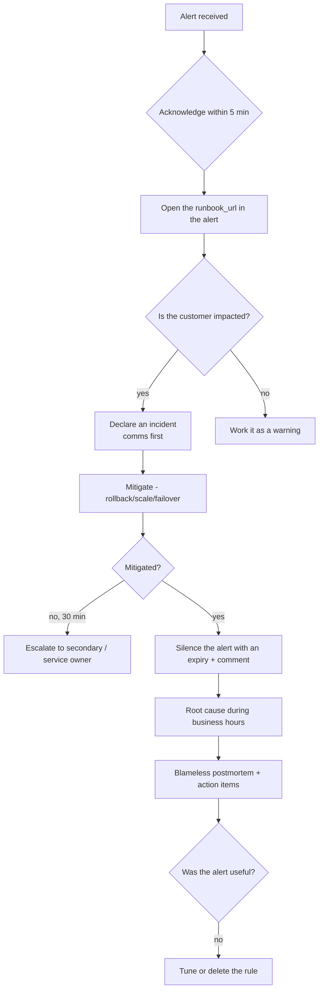

# Project 20 — Alerting, Notification Routing and On-Call Runbooks

| | |
|---|---|
| **Module** | 10 — Monitoring |
| **Level** | L3 — Senior |
| **Role you play** | SRE designing the alerting strategy and on-call process |
| **Scope** | `Prometheus-Grafana-hands-on.md` — alerting rules, Alertmanager 0.28.1, receivers, routing, silences |

---

## 1. Business problem

The monitoring platform from Project 19 shows everything — but only if someone is looking at a
screen. Meanwhile the previous attempt at alerting was abandoned because it generated 300 emails a
day: everyone filtered them to a folder, and the one real outage alert was filtered with them.

Design alerting that an on-call engineer will actually trust: **few, actionable, symptom-based**
alerts, routed to the right place by severity, with silences for maintenance, inhibition to stop
alert storms, and a runbook link in every single alert.

## 2. Objectives

1. Write Prometheus alerting rules based on **symptoms** (user impact), not every raw metric.
2. Deploy Alertmanager 0.28.1 with grouping, routing, inhibition and repeat intervals.
3. Route by severity: critical → chat/page, warning → chat, info → ticket queue.
4. Define SLOs and alert on **error budget burn rate**, not raw thresholds.
5. Write on-call runbooks and link them from every alert.
6. Prove the design with fault-injection drills and measure the alert volume.

## 3. Scope

**In scope:** `alerting_rules`, `for` clauses, labels/annotations, `promtool test rules`,
Alertmanager config (`route`, `group_by`, `group_wait`, `repeat_interval`, `receivers`,
`inhibit_rules`, `time_intervals`), webhook/email receivers, silences, `amtool`,
Grafana alert visualisation, multi-window burn-rate alerts.

**Out of scope:** paid paging platforms, incident management tooling, log-based alerting,
auto-remediation.

---

## 4. Standard Operating Procedure (SOP)

> **SOP ID:** ALR-SOP-020 · **Title:** Alerting standard and on-call procedure

### 4.1 The alerting contract

Every alert **must** satisfy all five:

| # | Test | If it fails |
|---|---|---|
| 1 | **Is a human affected?** Symptom, not cause | Make it a dashboard panel, not an alert |
| 2 | **Is it actionable?** There is something to do right now | Delete it or make it a ticket |
| 3 | **Is it urgent?** It cannot wait until business hours | Downgrade to `warning`/`info` |
| 4 | **Does it have a runbook?** `runbook_url` annotation | Do not ship it |
| 5 | **Will it be rare?** Expected to fire less than once a week | Tune the threshold/`for` window |

> If an alert fires and the correct response is "ignore it", **delete the alert**. An alert you
> ignore trains you to ignore all of them.

### 4.2 Severity definitions

| Severity | Meaning | Route | Response |
|---|---|---|---|
| `critical` | Customer-visible outage or imminent one | Page / chat `#oncall-critical` | Immediate, 24×7 |
| `warning` | Degraded, or will become critical soon | Chat `#platform-alerts` | Next business hour |
| `info` | Noteworthy, no action required now | Ticket queue / daily digest | Triage weekly |

### 4.3 Mandatory alert fields

```yaml
labels:
  severity: critical|warning|info
  service:  <service name>
  team:     <owning team>
annotations:
  summary:     "One line, includes the affected object"
  description: "What is happening, with the current value"
  impact:      "What the customer experiences"
  runbook_url: "https://runbooks.acme.local/<alert-name>"
  dashboard_url: "https://grafana.acme.local/d/<uid>"
```

### 4.4 On-call procedure



### 4.5 Silence policy
* Every silence requires a **comment** and an **expiry** — never silence indefinitely.
* Maximum silence duration without approval: 24 hours.
* Planned maintenance silences are created **before** the window and scoped by label, not by
  silencing everything.
* Review active silences weekly; a long-lived silence is a hidden outage.

### 4.6 Weekly alert review (the thing that keeps alerting healthy)
Count alerts per rule for the last 7 days. For each rule ask: did it page? was it actionable?
did it lead to a fix? Delete or tune anything that fails the contract in §4.1.

---

## 5. Hands-on implementation

### Step 1 — Install Alertmanager 0.28.1

```bash
AM_VERSION=0.28.1

sudo useradd --no-create-home --shell /bin/false alertmanager
sudo mkdir -p /etc/alertmanager /var/lib/alertmanager
sudo chown alertmanager:alertmanager /var/lib/alertmanager

cd /tmp
curl -fsSLO https://github.com/prometheus/alertmanager/releases/download/v${AM_VERSION}/alertmanager-${AM_VERSION}.linux-amd64.tar.gz
tar xzf alertmanager-${AM_VERSION}.linux-amd64.tar.gz
sudo cp alertmanager-${AM_VERSION}.linux-amd64/alertmanager /usr/local/bin/
sudo cp alertmanager-${AM_VERSION}.linux-amd64/amtool /usr/local/bin/
sudo chown alertmanager:alertmanager /usr/local/bin/alertmanager /usr/local/bin/amtool

alertmanager --version
```

`/etc/systemd/system/alertmanager.service`:

```ini
[Unit]
Description=Alertmanager
Wants=network-online.target
After=network-online.target

[Service]
User=alertmanager
Group=alertmanager
Type=simple
Restart=on-failure
RestartSec=5
ExecStart=/usr/local/bin/alertmanager \
  --config.file=/etc/alertmanager/alertmanager.yml \
  --storage.path=/var/lib/alertmanager \
  --web.listen-address=0.0.0.0:9093
ExecReload=/bin/kill -HUP $MAINPID

[Install]
WantedBy=multi-user.target
```

### Step 2 — Point Prometheus at Alertmanager

Add to `/etc/prometheus/prometheus.yml`:

```yaml
alerting:
  alertmanagers:
    - static_configs:
        - targets: ["localhost:9093"]

rule_files:
  - "/etc/prometheus/rules/*.yml"
```

### Step 3 — Alerting rules (symptom-based)

`/etc/prometheus/rules/alerts-infra.yml`:

```yaml
groups:
  - name: infrastructure
    rules:

      - alert: HostDown
        expr: up{job="node"} == 0
        for: 2m
        labels:
          severity: critical
          team: platform
        annotations:
          summary: "Host {{ $labels.instance }} is unreachable"
          description: "Prometheus has failed to scrape {{ $labels.instance }} for 2 minutes."
          impact: "Services on this host are unavailable."
          runbook_url: "https://runbooks.acme.local/HostDown"
          dashboard_url: "https://grafana.acme.local/d/node-full"

      - alert: HostDiskWillFillIn4Hours
        # Predictive: act BEFORE the outage, not after
        expr: |
          predict_linear(node_filesystem_avail_bytes{fstype!~"tmpfs|overlay"}[6h], 4*3600) < 0
          and node_filesystem_avail_bytes{fstype!~"tmpfs|overlay"} / node_filesystem_size_bytes < 0.25
        for: 15m
        labels:
          severity: warning
          team: platform
        annotations:
          summary: "Disk {{ $labels.mountpoint }} on {{ $labels.instance }} fills within 4h"
          description: "Current free: {{ $value | humanize1024 }}B, trending to zero."
          impact: "A full disk will cause write failures and service outage."
          runbook_url: "https://runbooks.acme.local/HostDiskWillFill"

      - alert: HostDiskCritical
        expr: |
          (1 - node_filesystem_avail_bytes{mountpoint="/"} / node_filesystem_size_bytes{mountpoint="/"}) > 0.92
        for: 5m
        labels:
          severity: critical
          team: platform
        annotations:
          summary: "Root filesystem {{ $labels.instance }} over 92% full"
          description: "{{ $value | humanizePercentage }} used."
          impact: "Imminent write failures."
          runbook_url: "https://runbooks.acme.local/HostDiskCritical"

      - alert: HostMemoryPressure
        expr: |
          (1 - (node_memory_MemAvailable_bytes / node_memory_MemTotal_bytes)) > 0.92
        for: 10m
        labels:
          severity: warning
          team: platform
        annotations:
          summary: "Memory pressure on {{ $labels.instance }}"
          description: "{{ $value | humanizePercentage }} of memory in use for 10 minutes."
          impact: "OOM killer may terminate processes."
          runbook_url: "https://runbooks.acme.local/HostMemoryPressure"

      - alert: HostUnexpectedReboot
        expr: (node_time_seconds - node_boot_time_seconds) < 300
        for: 0m
        labels:
          severity: info
          team: platform
        annotations:
          summary: "{{ $labels.instance }} rebooted in the last 5 minutes"
          description: "Uptime is {{ $value | humanizeDuration }}."
          impact: "In-flight requests on this host were dropped."
          runbook_url: "https://runbooks.acme.local/HostUnexpectedReboot"
```

`/etc/prometheus/rules/alerts-service.yml`:

```yaml
groups:
  - name: orders-service
    rules:

      - alert: OrdersServiceDown
        expr: up{job="orders-api"} == 0
        for: 1m
        labels:
          severity: critical
          service: orders
          team: payments
        annotations:
          summary: "Orders API is not responding on {{ $labels.instance }}"
          description: "Scrape of the orders API has failed for 1 minute."
          impact: "Customers cannot place orders."
          runbook_url: "https://runbooks.acme.local/OrdersServiceDown"

      - alert: OrdersHighErrorRate
        expr: job:orders_errors:ratio5m > 0.05
        for: 5m
        labels:
          severity: critical
          service: orders
          team: payments
        annotations:
          summary: "Orders API 5xx ratio is {{ $value | humanizePercentage }}"
          description: "Error ratio has exceeded 5% for 5 minutes."
          impact: "Roughly 1 in 20 customer orders is failing."
          runbook_url: "https://runbooks.acme.local/OrdersHighErrorRate"

      - alert: OrdersHighLatency
        expr: job:orders_latency_p95:5m > 1
        for: 10m
        labels:
          severity: warning
          service: orders
          team: payments
        annotations:
          summary: "Orders API p95 latency is {{ $value | humanizeDuration }}"
          description: "95th percentile latency above 1s for 10 minutes."
          impact: "Checkout feels slow; abandonment rises."
          runbook_url: "https://runbooks.acme.local/OrdersHighLatency"

      - alert: OrdersNoTraffic
        # Catches the silent failure mode: everything 'healthy' but nothing arriving
        expr: job:orders_requests:rate5m < 0.01
        for: 15m
        labels:
          severity: warning
          service: orders
          team: payments
        annotations:
          summary: "Orders API is receiving no traffic"
          description: "Request rate has been effectively zero for 15 minutes."
          impact: "Either a broken upstream/load balancer, or a real outage nobody reported."
          runbook_url: "https://runbooks.acme.local/OrdersNoTraffic"

      - alert: OrdersQueueBacklog
        expr: max(orders_queue_depth) > 100
        for: 10m
        labels:
          severity: warning
          service: orders
          team: payments
        annotations:
          summary: "Order processing backlog is {{ $value }}"
          description: "Queue depth above 100 for 10 minutes."
          impact: "Orders are accepted but not processed; fulfilment is delayed."
          runbook_url: "https://runbooks.acme.local/OrdersQueueBacklog"
```

### Step 4 — SLO and error-budget burn-rate alerting

`/etc/prometheus/rules/slo.yml`:

```yaml
groups:
  - name: orders-slo
    interval: 30s
    rules:
      # SLO: 99.5% of requests succeed  ->  error budget = 0.5%
      - record: slo:orders_availability:target
        expr: vector(0.995)

      - record: slo:orders_error_ratio:rate5m
        expr: |
          sum(rate(orders_http_requests_total{status=~"5.."}[5m]))
            / clamp_min(sum(rate(orders_http_requests_total[5m])), 0.001)

      - record: slo:orders_error_ratio:rate1h
        expr: |
          sum(rate(orders_http_requests_total{status=~"5.."}[1h]))
            / clamp_min(sum(rate(orders_http_requests_total[1h])), 0.001)

      - record: slo:orders_error_ratio:rate6h
        expr: |
          sum(rate(orders_http_requests_total{status=~"5.."}[6h]))
            / clamp_min(sum(rate(orders_http_requests_total[6h])), 0.001)

      # Multi-window, multi-burn-rate: fast burn pages, slow burn warns.
      # 14.4x burn over 1h would exhaust a 30-day budget in ~2 days.
      - alert: OrdersErrorBudgetFastBurn
        expr: |
          slo:orders_error_ratio:rate5m > (14.4 * 0.005)
          and
          slo:orders_error_ratio:rate1h > (14.4 * 0.005)
        for: 2m
        labels:
          severity: critical
          service: orders
          team: payments
        annotations:
          summary: "Orders error budget burning 14.4x too fast"
          description: "At this rate the 30-day budget is exhausted in about 2 days."
          impact: "Customer-visible failures well above the agreed reliability target."
          runbook_url: "https://runbooks.acme.local/OrdersErrorBudgetBurn"

      - alert: OrdersErrorBudgetSlowBurn
        expr: |
          slo:orders_error_ratio:rate1h > (6 * 0.005)
          and
          slo:orders_error_ratio:rate6h > (6 * 0.005)
        for: 15m
        labels:
          severity: warning
          service: orders
          team: payments
        annotations:
          summary: "Orders error budget burning 6x too fast"
          description: "Sustained elevated error rate; budget will be exhausted early."
          impact: "Reliability target at risk this month."
          runbook_url: "https://runbooks.acme.local/OrdersErrorBudgetBurn"
```

```bash
promtool check rules /etc/prometheus/rules/*.yml
sudo chown -R prometheus:prometheus /etc/prometheus/rules
curl -X POST http://localhost:9090/-/reload
```

Check `http://<vm-ip>:9090/alerts` — rules appear as `Inactive`.

### Step 5 — Unit-test the alert rules

`tests/alert-tests.yml`:

```yaml
rule_files:
  - /etc/prometheus/rules/alerts-service.yml

evaluation_interval: 1m

tests:
  - interval: 1m
    input_series:
      - series: 'up{job="orders-api", instance="10.128.0.12:8000"}'
        values: '1 1 1 0 0 0 0'
    alert_rule_test:
      - eval_time: 3m
        alertname: OrdersServiceDown
        exp_alerts: []                     # not yet - 'for: 1m' has not elapsed
      - eval_time: 5m
        alertname: OrdersServiceDown
        exp_alerts:
          - exp_labels:
              severity: critical
              service: orders
              team: payments
              job: orders-api
              instance: "10.128.0.12:8000"
            exp_annotations:
              summary: "Orders API is not responding on 10.128.0.12:8000"
              description: "Scrape of the orders API has failed for 1 minute."
              impact: "Customers cannot place orders."
              runbook_url: "https://runbooks.acme.local/OrdersServiceDown"
```

```bash
promtool test rules tests/alert-tests.yml
```

> Alert rules are code. Test them — discovering a broken rule during an outage is the worst
> possible time.

### Step 6 — Alertmanager configuration

`/etc/alertmanager/alertmanager.yml`:

```yaml
global:
  resolve_timeout: 5m
  # Credentials come from a file/secret manager - NEVER commit real values
  smtp_smarthost: 'smtp.acme.local:587'
  smtp_from: 'alerts@acme.local'
  smtp_auth_username: '<SMTP_USERNAME>'
  smtp_auth_password: '<SMTP_PASSWORD>'
  smtp_require_tls: true

templates:
  - '/etc/alertmanager/templates/*.tmpl'

route:
  receiver: 'default-chat'
  group_by: ['alertname', 'service', 'severity']
  group_wait: 30s          # let related alerts arrive before the first notification
  group_interval: 5m       # how often to send updates for an existing group
  repeat_interval: 4h      # re-notify about something still firing

  routes:
    # Critical -> page + chat, nag every hour until resolved
    - matchers:
        - severity = "critical"
      receiver: 'oncall-critical'
      group_wait: 10s
      repeat_interval: 1h
      continue: true       # also fall through to the chat receiver below

    # Payments team ownership
    - matchers:
        - team = "payments"
      receiver: 'payments-chat'
      group_by: ['alertname', 'service']

    # Warnings -> chat only, no paging, low nag
    - matchers:
        - severity = "warning"
      receiver: 'platform-chat'
      repeat_interval: 12h

    # Info -> daily digest, never at night
    - matchers:
        - severity = "info"
      receiver: 'ticket-queue'
      group_wait: 5m
      group_interval: 1h
      repeat_interval: 24h
      active_time_intervals:
        - business-hours

# Stop alert storms: one cause, one notification
inhibit_rules:
  # If the host is down, do not also page about every service on it
  - source_matchers: [ alertname = "HostDown" ]
    target_matchers: [ severity =~ "warning|info" ]
    equal: ['instance']

  # A critical alert suppresses the warning version of the same thing
  - source_matchers: [ severity = "critical" ]
    target_matchers: [ severity = "warning" ]
    equal: ['alertname', 'service']

  # A service being down suppresses its latency/error alerts
  - source_matchers: [ alertname = "OrdersServiceDown" ]
    target_matchers: [ alertname =~ "OrdersHighLatency|OrdersHighErrorRate|OrdersNoTraffic" ]
    equal: ['service']

time_intervals:
  - name: business-hours
    time_intervals:
      - weekdays: ['monday:friday']
        times:
          - start_time: '09:00'
            end_time:   '18:00'
        location: 'Europe/London'

receivers:

  - name: 'default-chat'
    webhook_configs:
      - url: 'http://localhost:5001/alerts'
        send_resolved: true

  - name: 'oncall-critical'
    # Slack-compatible incoming webhook.
    # The real URL lives in a secret manager and is injected at deploy time.
    slack_configs:
      - api_url: 'https://hooks.slack.com/services/<WORKSPACE_ID>/<CHANNEL_ID>/<TOKEN>'
        channel: '#oncall-critical'
        send_resolved: true
        title: '[{{ .Status | toUpper }}] {{ .CommonLabels.alertname }}'
        text: |
          {{ range .Alerts }}
          *{{ .Annotations.summary }}*
          Impact: {{ .Annotations.impact }}
          Service: {{ .Labels.service }} | Instance: {{ .Labels.instance }}
          Runbook: {{ .Annotations.runbook_url }}
          Dashboard: {{ .Annotations.dashboard_url }}
          {{ end }}
    email_configs:
      - to: 'oncall@acme.local'
        send_resolved: true

  - name: 'payments-chat'
    slack_configs:
      - api_url: 'https://hooks.slack.com/services/<WORKSPACE_ID>/<CHANNEL_ID>/<TOKEN>'
        channel: '#team-payments'
        send_resolved: true

  - name: 'platform-chat'
    slack_configs:
      - api_url: 'https://hooks.slack.com/services/<WORKSPACE_ID>/<CHANNEL_ID>/<TOKEN>'
        channel: '#platform-alerts'
        send_resolved: true

  - name: 'ticket-queue'
    email_configs:
      - to: 'platform-tickets@acme.local'
        send_resolved: false
```

> **Security note.** Never commit a real webhook URL, SMTP password or API key. Use
> `<ANGLE_BRACKET>` placeholders in Git and inject the real values from a secret manager at
> deploy time. A webhook URL committed to a public repo is a live credential the moment it is
> pushed — and rotating it is the only fix.

```bash
sudo mkdir -p /etc/alertmanager/templates
sudo chown -R alertmanager:alertmanager /etc/alertmanager

amtool check-config /etc/alertmanager/alertmanager.yml
sudo systemctl daemon-reload
sudo systemctl enable --now alertmanager
sudo systemctl status alertmanager --no-pager
```

```bash
gcloud compute firewall-rules create allow-alertmanager \
  --allow tcp:9093 --source-ranges <your-ip>/32
```

### Step 7 — A local webhook receiver (so the drills work without external services)

`tools/alert-sink.py`:

```python
#!/usr/bin/env python3
"""Minimal webhook receiver so alert routing can be tested without Slack/email."""
import json
from datetime import datetime

from flask import Flask, request

app = Flask(__name__)
LOGFILE = "alerts-received.log"


@app.route("/alerts", methods=["POST"])
def receive():
    payload = request.get_json(force=True)
    stamp = datetime.now().isoformat(timespec="seconds")
    lines = [f"\n===== {stamp} receiver={payload.get('receiver')} "
             f"status={payload.get('status')} ====="]
    for alert in payload.get("alerts", []):
        labels = alert.get("labels", {})
        ann = alert.get("annotations", {})
        lines.append(
            f"[{alert.get('status')}] {labels.get('alertname')} "
            f"severity={labels.get('severity')} service={labels.get('service')} "
            f"instance={labels.get('instance')}\n"
            f"    summary : {ann.get('summary')}\n"
            f"    impact  : {ann.get('impact')}\n"
            f"    runbook : {ann.get('runbook_url')}"
        )
    text = "\n".join(lines)
    print(text, flush=True)
    with open(LOGFILE, "a", encoding="utf-8") as fh:
        fh.write(text + "\n")
    return json.dumps({"ok": True}), 200


if __name__ == "__main__":
    app.run(host="0.0.0.0", port=5001)
```

```bash
~/appenv/bin/python tools/alert-sink.py &
```

### Step 8 — Drill A: fire a test alert end to end

```bash
# Inject an alert directly into Alertmanager
amtool alert add \
  alertname=DrillTest severity=critical service=orders team=payments \
  instance=test-host \
  --annotation=summary="Drill: synthetic critical alert" \
  --annotation=impact="None - this is a drill" \
  --annotation=runbook_url="https://runbooks.acme.local/DrillTest" \
  --alertmanager.url=http://localhost:9093

amtool alert --alertmanager.url=http://localhost:9093
tail -20 alerts-received.log
```

Verify in `http://<vm-ip>:9093`: the alert is grouped and routed to `oncall-critical`.

### Step 9 — Drill B: real fault injection

```bash
# 1. Service down -> OrdersServiceDown (critical)
pkill -f gunicorn
#    watch http://<ip>:9090/alerts go Pending -> Firing after 'for: 1m'
#    confirm OrdersHighErrorRate / NoTraffic are INHIBITED, not separately notified
tail -f alerts-received.log

~/appenv/bin/gunicorn -w 2 -b 0.0.0.0:8000 app:app &    # resolve it

# 2. Error-rate spike -> OrdersHighErrorRate + fast burn
#    temporarily raise the failure probability in app.py to 0.5 and restart
ab -n 3000 -c 20 -p /dev/null -T application/json http://10.128.0.12:8000/orders

# 3. Latency -> OrdersHighLatency (warning only, no page)
for i in $(seq 1 200); do curl -s http://10.128.0.12:8000/slow > /dev/null & done

# 4. Disk prediction -> HostDiskWillFillIn4Hours
fallocate -l 5G /tmp/filler
#    wait for the trend, then:
rm /tmp/filler

# 5. Host down -> HostDown (critical) and everything on it inhibited
sudo systemctl stop node_exporter
sudo systemctl start node_exporter
```

For each: record **time to fire**, **which receiver**, **whether resolution was notified**, and
**whether inhibition prevented duplicates**.

### Step 10 — Drill C: silences

```bash
# Planned maintenance on one host, scoped by label, with a comment and expiry
amtool silence add instance=10.128.0.12 \
  --duration=2h \
  --comment="CHG-10432 planned kernel patching - DevOps" \
  --author="$(whoami)" \
  --alertmanager.url=http://localhost:9093

amtool silence query --alertmanager.url=http://localhost:9093

# Verify alerts for that instance are suppressed while others still fire
sudo systemctl stop node_exporter      # on 10.128.0.12 -> no notification

# Expire the silence as soon as the work is done
amtool silence expire <silence-id> --alertmanager.url=http://localhost:9093
```

Then deliberately try a bad silence (no comment) to show policy enforcement is a process, not a
tool feature — and document it in the SOP.

### Step 11 — Measure the alert volume (prove it isn't noise)

```promql
# Alerts currently firing, by severity
sum by (severity) (ALERTS{alertstate="firing"})

# How often each rule fired over 7 days
sum by (alertname) (changes(ALERTS_FOR_STATE[7d]))

# Notifications sent by Alertmanager, by receiver
sum by (integration) (increase(alertmanager_notifications_total[7d]))

# Failed notifications - silent alerting is worse than no alerting
sum by (integration) (increase(alertmanager_notifications_failed_total[1h])) > 0
```

Add a **"Meta: alerting health"** Grafana dashboard with these panels, plus a panel for
`alertmanager_silences_active` so forgotten silences are visible.

> Target: fewer than **5 pages per on-call week**. If you exceed that, the weekly review
> (SOP §4.6) must tune or delete rules — not the engineer's notification settings.

### Step 12 — Write the runbooks

`runbooks/OrdersHighErrorRate.md`:

```markdown
# Runbook: OrdersHighErrorRate

**Severity:** critical · **Service:** orders · **Owner:** payments team

## What this means
More than 5% of Orders API requests returned 5xx for 5 minutes.
Roughly 1 in 20 customer orders is failing.

## Immediate checks (first 3 minutes)
1. Dashboard: Grafana → ACME → "Orders Service - RED".
   Is the error ratio rising, flat or falling?
2. Was there a deployment in the last 30 minutes?
   `kubectl -n shop rollout history deploy/api` / Jenkins build history.
3. Which endpoint?
   `topk(5, sum by (endpoint) (rate(orders_http_requests_total{status=~"5.."}[5m])))`
4. Are dependencies healthy? Check the DB host alerts and `OrdersQueueBacklog`.

## Mitigation (restore service first)
- **If a deploy preceded it:** roll back immediately.
  `kubectl -n shop rollout undo deploy/api`  (Project 18, SRE-SOP-018 §4.1)
- **If a dependency is down:** fail over / restart the dependency; enable the degraded mode flag.
- **If saturation:** scale out. `kubectl -n shop scale deploy/api --replicas=8`
- **If a single bad instance:** remove it from the pool and keep it for analysis.

## Verify recovery
- Error ratio below 1% for 10 minutes.
- Alert transitions to `resolved` and the resolution notification arrives.

## Escalation
No mitigation within 30 minutes → escalate to the payments service owner, then the engineering
manager. Declare a customer-facing incident if error ratio stays above 5% for 15 minutes.

## After the incident
- Expire any silence you created.
- Blameless postmortem within 3 working days.
- Confirm this alert was useful; if not, raise a tuning ticket.

## Related
- Dashboard: https://grafana.acme.local/d/orders-red
- SLO: 99.5% availability, 30-day window
- Alerts: OrdersErrorBudgetFastBurn, OrdersServiceDown
```

Write the same structure for `HostDown`, `HostDiskWillFillIn4Hours`, `OrdersServiceDown`,
`OrdersHighLatency`, `OrdersNoTraffic`, `OrdersQueueBacklog` and `OrdersErrorBudgetBurn`.

**Every `runbook_url` in a rule must resolve to a real page.** Verify:

```bash
grep -rho 'runbook_url: "\([^"]*\)"' /etc/prometheus/rules/ | \
  sed 's/.*runbook_url: "//; s/"$//' | sort -u | \
  while read -r u; do
    name="${u##*/}"
    if [ -f "runbooks/${name}.md" ]; then
      echo "OK      ${name}"
    else
      echo "MISSING ${name}"
    fi
  done
```

---

## 6. Acceptance criteria

- [ ] Every alert rule has `severity`, `team`, `summary`, `description`, `impact`, `runbook_url`
- [ ] Every `runbook_url` resolves to a real runbook (verified by the script in Step 12)
- [ ] Alerts are symptom-based; no alert fires that an engineer would routinely ignore
- [ ] `promtool check rules` and `promtool test rules` both pass
- [ ] Alertmanager routes by severity and team; `critical` reaches two receivers
- [ ] Inhibition proven: `HostDown` suppresses that host's other alerts; `OrdersServiceDown`
      suppresses latency/error/no-traffic alerts
- [ ] `info` alerts only notify during the `business-hours` time interval
- [ ] Resolution notifications are delivered (`send_resolved: true`)
- [ ] Multi-window burn-rate SLO alerts implemented and demonstrated
- [ ] Silences created with author, comment and expiry; expiry demonstrated
- [ ] Alerting-health dashboard shows volume per rule, failed notifications and active silences
- [ ] **No real secrets** anywhere in the committed config — placeholders only
- [ ] Measured page volume for a simulated week is under 5

---

## 7. Troubleshooting

| Symptom | Cause | Action |
|---|---|---|
| Rule shows in Prometheus but nothing is delivered | Prometheus not pointed at Alertmanager | Check the `alerting:` block and `http://<prom>:9090/status` |
| Alert fires but no notification | Route matcher doesn't match the labels | `amtool config routes test severity=critical service=orders` |
| Notifications fail silently | Bad webhook/SMTP credentials | `alertmanager_notifications_failed_total`; `journalctl -u alertmanager` |
| Alert storm during one outage | No inhibit rules, bad `group_by` | Add inhibition; group by `alertname`+`service`, not by `instance` |
| Pager fires then immediately resolves, repeatedly | Flapping threshold, no `for` clause | Add/extend `for`; widen the rate window |
| Alert never fires despite the condition | `for` longer than the condition lasts, or the expression returns no series | Test the expression in the Prometheus UI; check label names |
| Everything went quiet for days | A forgotten open-ended silence | Weekly silence review; `alertmanager_silences_active` panel |
| Resolved alerts never clear | `resolve_timeout` too long / `send_resolved: false` | Set `send_resolved: true`; tune `resolve_timeout` |
| On-call ignores alerts | Too many non-actionable alerts | Apply the §4.1 contract ruthlessly; delete rules |
| `amtool` can't connect | Wrong URL | `--alertmanager.url=http://localhost:9093` |
| Secret committed to Git | Real webhook/password in the config file | Rotate the credential immediately — removal from Git is **not** enough |

---

## 8. Cleanup

```bash
sudo systemctl disable --now alertmanager
pkill -f alert-sink.py
sudo rm -rf /var/lib/alertmanager /etc/alertmanager
gcloud compute firewall-rules delete allow-alertmanager
```

---

## 9. Deliverables

1. `monitoring/rules/` — infra, service and SLO rule files, plus `tests/alert-tests.yml`.
2. `monitoring/alertmanager.yml` with routing, inhibition and time intervals (placeholders only).
3. `ALR-SOP-020.md` — alerting contract, severity matrix, on-call flow, silence policy, weekly review.
4. `runbooks/` — one runbook per alert, all linked from `runbook_url`.
5. `tools/alert-sink.py` plus a captured `alerts-received.log` from the drills.
6. Drill report: time-to-fire, receiver, inhibition behaviour and resolution for each injected fault.
7. "Alerting health" dashboard JSON and a one-week alert volume summary.

---

## 10. Interview talking points

* *"How do you decide what to alert on?"* — Symptoms with customer impact that are urgent and
  actionable and have a runbook. Causes go on dashboards. If the response is "ignore it", the
  alert is deleted.
* *"How do you stop alert fatigue?"* — Grouping, inhibition, severity-based routing, `for` clauses
  to kill flapping, time intervals for non-urgent alerts, and a weekly review that deletes rules
  which never led to action. The target is a measured page count, not a feeling.
* *"What is burn-rate alerting?"* — Alerting on how fast you are consuming the SLO error budget
  across two windows, so a short severe spike pages and a slow steady leak warns — instead of a
  single arbitrary threshold that is wrong at both ends.
* *"What does `for:` do?"* — The condition must hold continuously before the alert transitions
  from Pending to Firing; it is the main defence against flapping.
* *"Grouping vs inhibition?"* — Grouping bundles related alerts into one notification; inhibition
  suppresses lower-level alerts entirely when a known root-cause alert is firing.
* *"What goes in a runbook?"* — What the alert means, the first three checks, mitigation steps
  (restore service first), how to verify recovery, escalation path, and post-incident actions.
* *"How do you handle secrets in alerting config?"* — Placeholders in Git, real values injected
  from a secret manager at deploy time. If a webhook URL is ever committed, rotate it — deleting
  the commit does not revoke the credential.

**CV bullet:** *Designed and implemented the organisation's alerting strategy — symptom-based
Prometheus rules with unit tests, multi-window SLO error-budget burn-rate alerts, Alertmanager
severity/team routing with inhibition and maintenance-window controls, runbook-linked
notifications and a measured alert-volume review process — replacing an ignored 300-email-a-day
system with fewer than five actionable pages per on-call week.*
