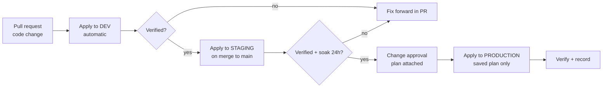

# Project 22 — Multi-Environment Promotion, Remote State and Drift Detection

| | |
|---|---|
| **Module** | 11 — Terraform |
| **Level** | L3 — Senior |
| **Role you play** | Cloud Platform Engineer owning the IaC platform across dev, staging and production |
| **Scope** | `Terraform-hands-on.md` — state, backends, workspaces, variables, modules, `import`, `-target` |

---

## 1. Business problem

The web tier is now code (Project 21), but the operating model is still fragile:

* state lives on **one engineer's laptop**, so nobody else can apply safely,
* two people applied at the same time last week and corrupted state,
* dev and production are "the same code" but nobody can prove it,
* someone fixed an incident in the console at 2 am and the change was silently reverted by the
  next apply,
* there are 12 legacy resources that pre-date Terraform and nobody dares touch them.

Deliver the **multi-environment IaC platform**: shared encrypted remote state with locking, a
promotion path dev → staging → production, automated **drift detection**, and a safe procedure
for adopting existing resources.

## 2. Objectives

1. Migrate state to a GCS remote backend with versioning and state locking.
2. Build the environment structure and compare the two approaches (workspaces vs directories).
3. Promote identical code with environment-specific inputs.
4. Automate drift detection with `terraform plan -detailed-exitcode`.
5. Adopt existing, manually created resources with `terraform import`.
6. Define emergency-change and destroy-safety procedures.

## 3. Scope

**In scope:** backends (`gcs`), state migration, locking, `terraform workspace`,
`-var-file`, per-environment directories, module versioning, `-detailed-exitcode`,
`-refresh-only`, `terraform import`/`import` blocks, `-target` (and why it is a last resort),
`-replace`, `prevent_destroy`, state inspection and `state rm`/`mv`.

**Out of scope:** Terraform Cloud/Enterprise, policy-as-code (Sentinel/OPA), building the web
tier itself (Project 21), pipeline construction (Module 8).

---

## 4. Standard Operating Procedure (SOP)

> **SOP ID:** IAC-SOP-022 · **Title:** Multi-environment state, promotion and drift control

### 4.1 Promotion path



**The same module version and the same code reach production — only the `.tfvars` differ.**

### 4.2 State rules

| # | Rule | Reason |
|---|---|---|
| 1 | State lives in a **remote, versioned, encrypted** bucket | Shared, recoverable, auditable |
| 2 | State locking is mandatory | Concurrent applies corrupt state |
| 3 | **One state file per environment** | A dev mistake can never touch production state |
| 4 | State is never edited by hand | Use `state mv`/`rm`/`import` |
| 5 | The state bucket has `prevent_destroy` and object versioning | State loss is the worst-case IaC failure |
| 6 | Access to the production state bucket is restricted by IAM | State contains secrets |
| 7 | Take a state backup before any `state` surgery | `terraform state pull > backup.json` |

### 4.3 Environment isolation: choose deliberately

| Approach | Use when | Risk |
|---|---|---|
| **Workspaces** (one config, many states) | Environments are genuinely identical; short-lived/ephemeral envs | Easy to apply to the wrong workspace; divergence needs conditionals, which get ugly |
| **Directories** (`envs/dev`, `envs/prod`) | Production matters; environments differ in size/features | More files, but explicit, reviewable and hard to confuse |

> **Standard for this platform: directories.** Workspaces are demonstrated and understood, but the
> blast radius of `terraform workspace select` being forgotten is a production outage.

### 4.4 Drift procedure

| Exit code of `plan -detailed-exitcode` | Meaning | Action |
|---|---|---|
| `0` | No changes — infrastructure matches code | None |
| `1` | Error | Fix the error; investigate immediately |
| `2` | **Drift or pending changes** | Triage below |

Drift triage:
1. Identify what changed and who changed it (Cloud Audit Logs).
2. **Was it an approved emergency change?**
   * Yes → codify it: update Terraform to match, raise a PR, apply. The fix becomes permanent.
   * No → revert it by applying Terraform, and follow up on the process breach.
3. Record every drift event. Repeated drift on the same resource means either the code is wrong
   or a process is broken.
4. Never "fix" drift by deleting the resource from state.

### 4.5 Emergency console change procedure
Console changes during an incident are permitted **only** when they are the fastest mitigation.
The on-call engineer must:
1. Record exactly what was changed, in the incident channel.
2. Raise a follow-up ticket **the same day**.
3. Codify the change in Terraform within 2 working days, or the next apply silently reverts the
   fix and re-creates the incident.

### 4.6 Destroy safety
* `prevent_destroy = true` on data stores, state buckets and production networks.
* `terraform destroy` against production requires a change ticket, a reviewed destroy plan and
  two engineers.
* Always `terraform plan -destroy -out=` and read the full list before applying.

---

## 5. Hands-on implementation

### Step 1 — Create the state bucket (bootstrap, applied once)

`bootstrap/main.tf`:

```hcl
terraform {
  required_version = ">= 1.9.0"
  required_providers {
    google = {
      source  = "hashicorp/google"
      version = "~> 6.0"
    }
  }
  # Bootstrap uses LOCAL state - it creates the bucket the others use.
}

provider "google" {
  project = var.project_id
  region  = var.region
}

variable "project_id" { type = string }
variable "region" {
  type    = string
  default = "europe-west2"
}
variable "state_bucket_name" {
  description = "Globally unique name for the Terraform state bucket"
  type        = string
}

resource "google_storage_bucket" "tfstate" {
  name          = var.state_bucket_name
  location      = var.region
  force_destroy = false

  uniform_bucket_level_access = true
  public_access_prevention    = "enforced"

  versioning {
    enabled = true # every state write is recoverable
  }

  lifecycle_rule {
    condition {
      num_newer_versions = 20
    }
    action {
      type = "Delete"
    }
  }

  labels = {
    purpose    = "terraform-state"
    managed_by = "terraform"
  }

  lifecycle {
    prevent_destroy = true # losing state is the worst-case failure
  }
}

output "state_bucket" {
  value = google_storage_bucket.tfstate.name
}
```

```bash
cd bootstrap
terraform init
terraform apply -var="project_id=<your-project-id>" \
                -var="state_bucket_name=<your-project-id>-tfstate"
cd ..

gsutil versioning get gs://<your-project-id>-tfstate
```

Restrict access to production state:

```bash
gcloud storage buckets add-iam-policy-binding gs://<your-project-id>-tfstate \
  --member="serviceAccount:terraform-sa@<your-project-id>.iam.gserviceaccount.com" \
  --role="roles/storage.objectAdmin"
```

### Step 2 — Repository structure (directory-per-environment)

```
terraform-platform/
├── bootstrap/
├── modules/
│   └── web-tier/              # the module from Project 21, versioned
│       ├── main.tf
│       ├── variables.tf
│       └── outputs.tf
├── envs/
│   ├── dev/
│   │   ├── backend.tf
│   │   ├── main.tf
│   │   └── dev.tfvars
│   ├── staging/
│   │   ├── backend.tf
│   │   ├── main.tf
│   │   └── staging.tfvars
│   └── prod/
│       ├── backend.tf
│       ├── main.tf
│       └── prod.tfvars
├── scripts/
│   ├── drift-check.sh
│   └── tf.sh
└── .gitignore
```

### Step 3 — Backend configuration per environment

`envs/dev/backend.tf`:

```hcl
terraform {
  required_version = ">= 1.9.0, < 2.0.0"

  required_providers {
    google = {
      source  = "hashicorp/google"
      version = "~> 6.0"
    }
  }

  backend "gcs" {
    bucket = "<your-project-id>-tfstate"
    prefix = "envs/dev" # SEPARATE state object per environment
  }
}
```

`envs/prod/backend.tf` is identical except `prefix = "envs/prod"`.

> GCS backends provide **state locking automatically** — no separate lock table is required.

### Step 4 — Identical code, different inputs

`envs/dev/main.tf` (staging and prod are the same file):

```hcl
provider "google" {
  project = var.project_id
  region  = var.region
  zone    = var.zone
}

variable "project_id"          { type = string }
variable "region"              { type = string }
variable "zone"                { type = string }
variable "environment"         { type = string }
variable "machine_type"        { type = string }
variable "instance_count"      { type = number }
variable "subnet_cidr"         { type = string }
variable "admin_source_ranges" { type = list(string) }
variable "enable_deletion_protection" {
  type    = bool
  default = false
}

module "web_tier" {
  source = "../../modules/web-tier"

  project_id                 = var.project_id
  region                     = var.region
  zone                       = var.zone
  environment                = var.environment
  app_name                   = "web"
  owner                      = "platform-team"
  machine_type               = var.machine_type
  instance_count             = var.instance_count
  subnet_cidr                = var.subnet_cidr
  admin_source_ranges        = var.admin_source_ranges
  enable_deletion_protection = var.enable_deletion_protection
}

output "application_url" {
  value = module.web_tier.application_url
}

output "load_balancer_ip" {
  value = module.web_tier.load_balancer_ip
}
```

`envs/dev/dev.tfvars`:

```hcl
project_id                 = "<your-project-id>"
region                     = "europe-west2"
zone                       = "europe-west2-a"
environment                = "dev"
machine_type               = "e2-micro"
instance_count             = 1
subnet_cidr                = "10.10.0.0/24"
admin_source_ranges        = ["<your-ip>/32"]
enable_deletion_protection = false
```

`envs/staging/staging.tfvars`:

```hcl
project_id                 = "<your-project-id>"
region                     = "europe-west2"
zone                       = "europe-west2-b"
environment                = "staging"
machine_type               = "e2-micro"
instance_count             = 2
subnet_cidr                = "10.20.0.0/24"
admin_source_ranges        = ["<your-ip>/32"]
enable_deletion_protection = false
```

`envs/prod/prod.tfvars`:

```hcl
project_id                 = "<your-project-id>"
region                     = "europe-west2"
zone                       = "europe-west2-c"
environment                = "prod"
machine_type               = "e2-small"
instance_count             = 3
subnet_cidr                = "10.30.0.0/24"
admin_source_ranges        = ["<office-cidr>/28"]
enable_deletion_protection = true
```

> The **only** difference between environments is the tfvars file. That is the whole point: if
> the code is identical, staging genuinely tests production.

Add deletion protection inside the module:

```hcl
resource "google_compute_subnetwork" "subnet" {
  # ...
  lifecycle {
    prevent_destroy = true # applies in every environment; override by editing code, deliberately
  }
}
```

### Step 5 — Migrate existing local state to the backend

```bash
cd envs/dev
cp ../../terraform-web-tier/terraform.tfstate .    # the Project 21 local state

terraform state pull > ../../backups/dev-pre-migration.json   # ALWAYS back up first

terraform init -migrate-state
# Terraform asks: "Do you want to copy existing state to the new backend?" -> yes

terraform state list                 # resources now read from GCS
gsutil ls gs://<your-project-id>-tfstate/envs/dev/

rm -f terraform.tfstate terraform.tfstate.backup   # local copies are now misleading
terraform plan -var-file=dev.tfvars                # must be "No changes"
```

### Step 6 — Prove state locking works

Terminal 1:

```bash
cd envs/dev
terraform apply -var-file=dev.tfvars    # leave it at the confirmation prompt
```

Terminal 2:

```bash
cd envs/dev
terraform plan -var-file=dev.tfvars
# Error: Error acquiring the state lock
#   Lock Info: ID, Operation, Who, Created
```

> This is exactly the protection that was missing when two engineers corrupted state. If a lock
> is genuinely stale (crashed run), `terraform force-unlock <lock-id>` — **only** after confirming
> nobody is applying.

### Step 7 — A thin wrapper so the environment is never ambiguous

`scripts/tf.sh`:

```bash
#!/usr/bin/env bash
# Wrapper that makes "which environment am I in?" impossible to get wrong.
set -euo pipefail

ENVIRONMENT="${1:?usage: tf.sh <dev|staging|prod> <plan|apply|destroy|output|...> [args]}"
shift
ACTION="${1:?action required}"
shift || true

case "$ENVIRONMENT" in
  dev|staging|prod) ;;
  *) echo "Unknown environment: $ENVIRONMENT"; exit 1 ;;
esac

DIR="envs/${ENVIRONMENT}"
VARS="${ENVIRONMENT}.tfvars"

cd "$(dirname "$0")/../${DIR}"

if [[ "$ENVIRONMENT" == "prod" && ( "$ACTION" == "apply" || "$ACTION" == "destroy" ) ]]; then
  echo "=============================================="
  echo " PRODUCTION ${ACTION^^}"
  echo "=============================================="
  read -r -p "Type the word PRODUCTION to continue: " confirm
  [[ "$confirm" == "PRODUCTION" ]] || { echo "Aborted."; exit 1; }
  read -r -p "Change ticket reference: " ticket
  [[ -n "$ticket" ]] || { echo "A change ticket is required. Aborted."; exit 1; }
  echo "Proceeding under ticket ${ticket}"
fi

terraform init -input=false

case "$ACTION" in
  plan)
    terraform plan -input=false -var-file="$VARS" -out="${ENVIRONMENT}.tfplan" "$@"
    terraform show -no-color "${ENVIRONMENT}.tfplan" > "${ENVIRONMENT}-plan-review.txt"
    echo "Plan review saved: ${DIR}/${ENVIRONMENT}-plan-review.txt"
    ;;
  apply)
    [[ -f "${ENVIRONMENT}.tfplan" ]] || { echo "No saved plan. Run plan first."; exit 1; }
    terraform apply -input=false "${ENVIRONMENT}.tfplan"
    rm -f "${ENVIRONMENT}.tfplan"
    ;;
  *)
    terraform "$ACTION" -var-file="$VARS" "$@"
    ;;
esac
```

```bash
chmod +x scripts/tf.sh

./scripts/tf.sh dev plan
./scripts/tf.sh dev apply
./scripts/tf.sh staging plan
./scripts/tf.sh staging apply
./scripts/tf.sh prod plan            # review, attach to the change ticket
./scripts/tf.sh prod apply           # requires typing PRODUCTION + a ticket
```

### Step 8 — Workspaces (understand them, then choose not to use them)

```bash
cd envs/dev

terraform workspace list
terraform workspace new feature-x
terraform workspace list            # * marks the current one
terraform workspace show

# ${terraform.workspace} lets one config build many copies
terraform plan -var-file=dev.tfvars -var="environment=feature-x"

terraform workspace select default
terraform workspace delete feature-x
```

Document the trade-off in the SOP:

```hcl
# Workspace-aware sizing - works, but conditionals multiply quickly
locals {
  instance_count = terraform.workspace == "prod" ? 3 : 1
  machine_type   = terraform.workspace == "prod" ? "e2-small" : "e2-micro"
}
```

> Good for ephemeral per-developer or per-PR environments. Not used for dev/staging/prod here,
> because forgetting `workspace select` applies dev's plan to production's state.

### Step 9 — Automated drift detection

`scripts/drift-check.sh`:

```bash
#!/usr/bin/env bash
# Detect drift across all environments. Designed for a scheduled job.
# Exit codes: 0 = no drift anywhere, 2 = drift found, 1 = error.
set -uo pipefail

ENVIRONMENTS=("dev" "staging" "prod")
REPORT="drift-report-$(date +%Y%m%d-%H%M%S).txt"
OVERALL=0

{
  echo "Terraform drift report"
  echo "Generated: $(date -Is)"
  echo "======================================"
} > "$REPORT"

for env in "${ENVIRONMENTS[@]}"; do
  echo "--- checking ${env} ---"
  pushd "envs/${env}" > /dev/null || { OVERALL=1; continue; }

  terraform init -input=false -no-color > /dev/null 2>&1

  # -detailed-exitcode: 0 = no changes, 1 = error, 2 = changes/drift
  terraform plan -input=false -no-color -detailed-exitcode \
      -var-file="${env}.tfvars" -out="${env}-drift.tfplan" > "/tmp/${env}-plan.txt" 2>&1
  CODE=$?

  {
    echo ""
    echo "=== ENVIRONMENT: ${env} (exit ${CODE}) ==="
  } >> "../../${REPORT}"

  case $CODE in
    0)
      echo "OK: ${env} matches code"
      echo "NO DRIFT - infrastructure matches configuration." >> "../../${REPORT}"
      ;;
    2)
      echo "DRIFT: ${env} has changes"
      [[ $OVERALL -ne 1 ]] && OVERALL=2
      {
        echo "DRIFT DETECTED. Resources affected:"
        grep -E '^\s+#\s' "/tmp/${env}-plan.txt" || true
        echo ""
        echo "Summary line:"
        grep -E '^Plan:' "/tmp/${env}-plan.txt" || true
        echo ""
        echo "Full plan:"
        cat "/tmp/${env}-plan.txt"
      } >> "../../${REPORT}"
      ;;
    *)
      echo "ERROR: ${env} plan failed"
      OVERALL=1
      {
        echo "PLAN ERROR:"
        cat "/tmp/${env}-plan.txt"
      } >> "../../${REPORT}"
      ;;
  esac

  rm -f "${env}-drift.tfplan"
  popd > /dev/null
done

echo ""
echo "Report written: ${REPORT}"
exit $OVERALL
```

```bash
chmod +x scripts/drift-check.sh
./scripts/drift-check.sh; echo "exit=$?"
```

Schedule it (and alert on the result — Module 10):

```bash
# /etc/cron.d/terraform-drift
0 7 * * 1-5 deploy cd /opt/terraform-platform && ./scripts/drift-check.sh \
  || curl -s -X POST -H 'Content-type: application/json' \
       --data '{"text":"Terraform drift detected - see the drift report"}' \
       'https://hooks.slack.com/services/<WORKSPACE_ID>/<CHANNEL_ID>/<TOKEN>'
```

> The webhook URL is a placeholder. Inject the real one from a secret manager — a webhook
> committed to Git is a live credential and must be rotated, not merely deleted.

### Step 10 — Drill A: create drift and resolve it both ways

```bash
# Someone "fixes" something in the console
INSTANCE=$(gcloud compute instances list --filter="name~'dev-web-vm'" \
  --format='value(name)' | head -1)
ZONE=$(gcloud compute instances list --filter="name='${INSTANCE}'" \
  --format='value(zone)')

gcloud compute instances add-labels "$INSTANCE" --zone "$ZONE" \
  --labels=hotfix=incident-4471

gcloud compute firewall-rules update dev-web-allow-ssh \
  --source-ranges=0.0.0.0/0          # the classic 2am mistake
```

Detect it:

```bash
./scripts/drift-check.sh; echo "exit=$?"     # exit 2
grep -A5 "DRIFT DETECTED" drift-report-*.txt
```

Inspect without changing anything:

```bash
cd envs/dev
terraform plan -refresh-only -var-file=dev.tfvars
# shows what the real world now looks like vs state
```

**Resolution path 1 — revert the unauthorised change** (the firewall):

```bash
./scripts/tf.sh dev plan
./scripts/tf.sh dev apply
gcloud compute firewall-rules describe dev-web-allow-ssh --format='value(sourceRanges)'
# back to <your-ip>/32
```

**Resolution path 2 — codify an approved change** (the label):

```hcl
# in modules/web-tier, add the label properly
locals {
  common_labels = merge({
    env        = var.environment
    app        = var.app_name
    owner      = var.owner
    managed_by = "terraform"
  }, var.extra_labels)
}
```

```bash
# dev.tfvars
extra_labels = { hotfix = "incident-4471" }
```

```bash
./scripts/tf.sh dev plan      # the drift is now the desired state
./scripts/tf.sh dev apply
./scripts/drift-check.sh      # exit 0
```

### Step 11 — Drill B: adopt existing resources with `import`

Create something "legacy" outside Terraform:

```bash
gcloud compute addresses create legacy-static-ip --region europe-west2
gcloud compute addresses describe legacy-static-ip --region europe-west2
```

Write the matching configuration first:

```hcl
# envs/dev/legacy.tf
resource "google_compute_address" "legacy" {
  name   = "legacy-static-ip"
  region = "europe-west2"
}

# Terraform 1.5+ : declarative import, reviewable in a plan
import {
  to = google_compute_address.legacy
  id = "projects/<your-project-id>/regions/europe-west2/addresses/legacy-static-ip"
}
```

```bash
cd envs/dev
terraform state pull > ../../backups/dev-pre-import.json

terraform plan -var-file=dev.tfvars
# "1 to import, 0 to add, 0 to change, 0 to destroy"  <- the goal

terraform apply -var-file=dev.tfvars
terraform state show google_compute_address.legacy
```

Generate configuration automatically when you don't know every attribute:

```bash
terraform plan -generate-config-out=generated.tf -var-file=dev.tfvars
cat generated.tf      # then clean it up and move it into the right file
```

The CLI equivalent (older workflow):

```bash
terraform import -var-file=dev.tfvars \
  google_compute_address.legacy \
  projects/<your-project-id>/regions/europe-west2/addresses/legacy-static-ip
```

> Import does **not** write configuration. If the resource block is missing or wrong, the next
> plan proposes destroying the resource you just adopted. Always confirm a clean plan afterwards.

Remove the `import` block once applied — it has done its job.

### Step 12 — Drill C: state surgery, safely

```bash
cd envs/dev
terraform state pull > ../../backups/dev-pre-surgery.json   # mandatory

terraform state list
terraform state show module.web_tier.google_compute_health_check.web

# Rename a resource without destroying it (prefer a moved block in code)
terraform state mv \
  google_compute_address.legacy \
  google_compute_address.shared_static_ip

# Stop managing something WITHOUT deleting it from the cloud
terraform state rm google_compute_address.shared_static_ip
gcloud compute addresses describe legacy-static-ip --region europe-west2   # still exists

# Recreate a single corrupted resource (replaces the old -taint)
terraform plan -replace=module.web_tier.google_compute_health_check.web -var-file=dev.tfvars
```

Recover from a bad state write using bucket versioning:

```bash
gsutil ls -a gs://<your-project-id>-tfstate/envs/dev/default.tfstate
gsutil cp gs://<your-project-id>-tfstate/envs/dev/default.tfstate#<generation> ./recovered.tfstate
terraform state push recovered.tfstate     # last resort, with the team watching
```

### Step 13 — `-target`: why it is a last resort

```bash
# Permitted only during an incident, never as routine practice
terraform apply -var-file=dev.tfvars \
  -target=module.web_tier.google_compute_region_instance_group_manager.web
```

Terraform itself warns that this is for exceptional circumstances. It applies a **partial** plan,
so dependent resources can be left inconsistent. Afterwards you must run a full plan/apply to
reconcile — and document why it was needed.

### Step 14 — Drill D: destroy safety

```bash
cd envs/prod
terraform plan -destroy -var-file=prod.tfvars -out=destroy.tfplan
# FAILS on prevent_destroy for the subnet - exactly as designed

terraform show -no-color destroy.tfplan | grep -E '^\s+#' | head -40
```

To genuinely decommission, a code change (removing `prevent_destroy`) must go through review —
it cannot be done with a CLI flag. Document that as the control.

Tear down the lab environments in the right order:

```bash
./scripts/tf.sh dev destroy -auto-approve=false
./scripts/tf.sh staging destroy
# prod requires typing PRODUCTION and a ticket reference
```

### Step 15 — Prove environment parity

```bash
# Same module, same code, different inputs - demonstrate it
diff <(sed 's/dev/ENV/g' envs/dev/main.tf) <(sed 's/prod/ENV/g' envs/prod/main.tf)
# only the backend prefix and tfvars differ

for e in dev staging prod; do
  echo "=== $e ==="
  (cd "envs/$e" && terraform output -json 2>/dev/null | python3 -m json.tool)
done
```

---

## 6. Acceptance criteria

- [ ] State stored in a GCS bucket with versioning, UBLA, public-access prevention and `prevent_destroy`
- [ ] One state prefix per environment; dev cannot touch prod state
- [ ] State locking demonstrated with a concurrent-apply error
- [ ] Local state migrated with `-migrate-state` and a backup taken beforehand
- [ ] Identical module code across dev/staging/prod; only `.tfvars` differ (proved by `diff`)
- [ ] Production apply requires explicit confirmation and a change ticket (wrapper script)
- [ ] Plans are saved and reviewed; `apply` only consumes a saved plan
- [ ] `drift-check.sh` returns 0/2/1 correctly and produces a readable report
- [ ] Drift drill completed with **both** resolutions: revert unauthorised, codify approved
- [ ] Existing resource adopted via an `import` block with a clean follow-up plan
- [ ] `state mv`/`rm`/`-replace` demonstrated, each preceded by a state backup
- [ ] `prevent_destroy` blocks a production destroy plan
- [ ] Workspaces demonstrated and the deliberate decision not to use them documented
- [ ] No secrets, state files or plan files in Git

---

## 7. Troubleshooting

| Symptom | Cause | Action |
|---|---|---|
| `Error acquiring the state lock` | Another apply is running, or a crashed run | Wait; confirm nobody is applying, then `terraform force-unlock <id>` |
| `Backend configuration changed` | Backend block edited | `terraform init -reconfigure` (new state) or `-migrate-state` (move it) |
| `Error loading state: storage: object doesn't exist` | Wrong bucket/prefix | Check `backend.tf`; `gsutil ls` the prefix |
| Plan wants to destroy everything | Wrong workspace/state, or lost state | **Stop.** Verify the backend prefix and workspace before anything else |
| `-detailed-exitcode` always returns 2 | Non-deterministic attributes, or genuinely pending changes | Read the plan; stabilise with `ignore_changes` only if truly external |
| Drift reappears every week | Something automated is changing it | Find the agent/process; either codify it or stop it |
| Import succeeds, next plan destroys the resource | Configuration doesn't match reality | Fix attributes until the plan is clean; use `-generate-config-out` |
| `terraform destroy` fails | `prevent_destroy` | Working as intended; change code via PR if decommissioning is genuinely approved |
| State file grew huge | Too many resources in one state | Split by environment and by layer (network / compute / data) |
| Applied to the wrong environment | Forgot `workspace select` or wrong directory | Use the wrapper script; prefer directories over workspaces |
| Provider upgrade proposes mass changes | Unpinned version | Pin `~>`, commit `.terraform.lock.hcl`, always plan after upgrades |
| Lost state entirely | No versioning/backups | Restore from bucket object versioning; otherwise re-import every resource |

---

## 8. Cleanup

```bash
./scripts/tf.sh dev destroy
./scripts/tf.sh staging destroy
./scripts/tf.sh prod destroy          # requires confirmation + ticket

# Bucket last - it holds the state for everything above
cd bootstrap
# remove prevent_destroy deliberately, then:
terraform destroy -var="project_id=<your-project-id>" \
                  -var="state_bucket_name=<your-project-id>-tfstate"
```

---

## 9. Deliverables

1. `terraform-platform/` repository: `bootstrap/`, `modules/`, `envs/{dev,staging,prod}/`, `scripts/`.
2. `IAC-SOP-022.md` — promotion diagram, state rules, isolation decision, drift procedure,
   emergency-change procedure, destroy safety.
3. `scripts/drift-check.sh` and `scripts/tf.sh`, plus a real `drift-report-*.txt` showing
   detection and resolution.
4. Evidence: state-lock error screenshot, `-migrate-state` transcript, `1 to import, 0 to change`
   plan, `prevent_destroy` blocking a destroy plan.
5. Drift incident log: what drifted, who changed it, which resolution path was taken and why.
6. A one-page comparison of workspaces vs directories with the recorded decision.

---

## 10. Interview talking points

* *"How do you manage multiple environments?"* — Identical module code, one state prefix per
  environment, differences expressed only in tfvars. I prefer directories over workspaces because
  a forgotten `workspace select` applies to the wrong environment.
* *"Why remote state?"* — Shared access, locking to prevent concurrent corruption, versioning for
  recovery, and IAM-controlled access because state contains secrets in plaintext.
* *"What is drift and how do you handle it?"* — Reality diverging from code, usually from console
  changes. I detect it on a schedule with `plan -detailed-exitcode`, then either revert it or
  codify it — and I always find out who changed it and why.
* *"Someone fixed production in the console during an incident. Now what?"* — Good: service was
  restored. Then it must be codified within two days, or the next apply silently reverts the fix
  and recreates the incident.
* *"How do you bring existing infrastructure under Terraform?"* — Write the resource block first,
  use an `import` block (or `-generate-config-out`), and confirm the plan shows zero changes.
  Import alone writes no configuration.
* *"Two engineers applied at once — how do you prevent that?"* — Backend state locking, plus
  applying only through a pipeline so there is one serialised path to production.
* *"When would you use `-target`?"* — Only during an incident, knowing it produces a partial apply,
  followed immediately by a full reconciling plan and a written justification.
* *"What's your worst-case IaC failure?"* — Losing state. Mitigated with bucket versioning,
  restricted IAM, `prevent_destroy`, and a backup before any state surgery.

**CV bullet:** *Established the multi-environment Terraform platform — encrypted versioned GCS
remote state with locking and per-environment isolation, a reviewed dev→staging→production
promotion path driven by a guarded wrapper script, scheduled drift detection with automated
alerting and a documented drift-resolution procedure, and safe adoption of legacy resources via
import — eliminating laptop-held state, concurrent-apply corruption and silent configuration
drift.*
